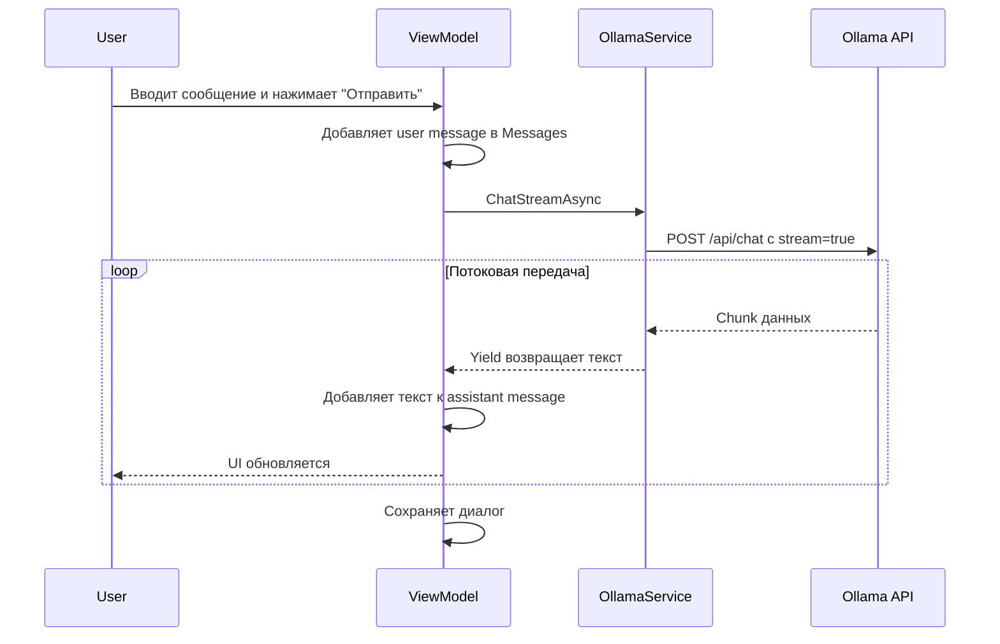
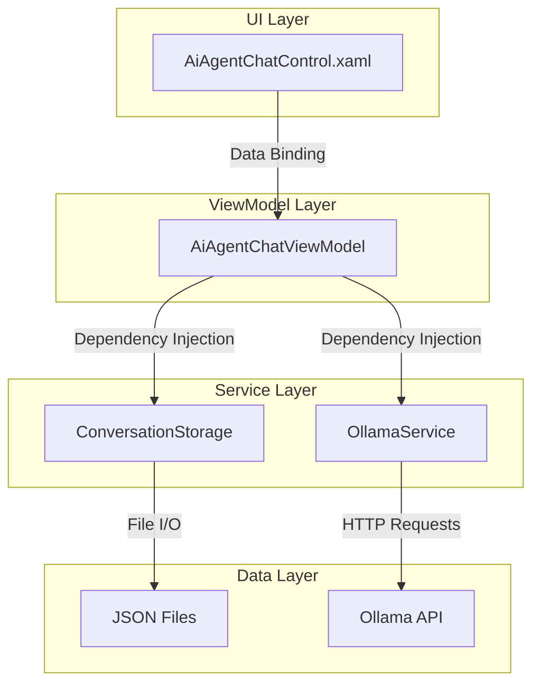

# Архитектура контрола AiAgentChatControl

## Обзор

Контрол для чата с локальным AI через Ollama API. Реализован с использованием WPF и паттерна MVVM.

## Ollama API Endpoints

Ollama предоставляет REST API на `http://localhost:11434`. Необходимые endpoints:

### 1. Получение списка моделей
```http
GET /api/tags
```
Ответ:
```json
{
  "models": [
    {
      "name": "llama2:latest",
      "modified_at": "2023-08-02T17:02:23.713454393-07:00",
      "size": 3825819519
    }
  ]
}
```

### 2. Чат с моделью (с поддержкой streaming)
```http
POST /api/chat
Content-Type: application/json
```
Тело запроса:
```json
{
  "model": "llama2:latest",
  "messages": [
    {
      "role": "user",
      "content": "Привет!"
    }
  ],
  "stream": true
}
```

Ответ (streaming):
```json
{"model":"llama2","message":{"role":"assistant","content":"Привет"}}
{"model":"llama2","message":{"role":"assistant","content":"!"}}
{"done":false}
{"done":true}
```

## Структура проекта

```
AiAgent/
├── Control/
│   ├── AiAgentChatControl.xaml          # UI контрол
│   └── AiAgentChatControl.xaml.cs       # Code-behind
├── Models/
│   ├── ChatMessage.cs                   # Модель сообщения
│   ├── Conversation.cs                  # Модель диалога
│   ├── OllamaModel.cs                   # Модель Ollama
│   └── OllamaResponse.cs                # Модель ответа API
├── Services/
│   ├── IOllamaService.cs                # Интерфейс сервиса
│   ├── OllamaService.cs                 # Реализация API клиента
│   ├── IConversationStorage.cs          # Интерфейс хранилища
│   └── JsonConversationStorage.cs       # Сохранение в JSON
├── ViewModels/
│   ├── AiAgentChatViewModel.cs          # ViewModel для чата
│   └── RelayCommand.cs                  # Command helper
└── Converters/
    ├── MessageAlignmentConverter.cs     # Выравнивание сообщений
    └── MessageBackgroundConverter.cs    # Цвет фона сообщений
```

## Модели данных

### ChatMessage
```csharp
public class ChatMessage : INotifyPropertyChanged
{
    public string Role { get; set; }           // "user" или "assistant"
    public string Content { get; set; }        // Текст сообщения
    public DateTime Timestamp { get; set; }    // Время отправки
    public bool IsStreaming { get; set; }      // Флаг потоковой передачи
}
```

### Conversation
```csharp
public class Conversation
{
    public Guid Id { get; set; }
    public string Title { get; set; }
    public DateTime CreatedAt { get; set; }
    public DateTime UpdatedAt { get; set; }
    public string ModelName { get; set; }
    public ObservableCollection<ChatMessage> Messages { get; set; }
}
```

### OllamaModel
```csharp
public class OllamaModel
{
    public string Name { get; set; }
    public DateTime ModifiedAt { get; set; }
    public long Size { get; set; }
}
```

## Архитектура сервисов

### IOllamaService
Интерфейс для взаимодействия с Ollama API:

```csharp
public interface IOllamaService
{
    Task<List<OllamaModel>> GetModelsAsync();
    
    IAsyncEnumerable<string> ChatStreamAsync(
        string model, 
        List<ChatMessage> messages,
        CancellationToken cancellationToken = default
    );
    
    Task<bool> IsOllamaRunningAsync();
}
```

### OllamaService
Реализация с использованием HttpClient:

```csharp
public class OllamaService : IOllamaService
{
    private readonly HttpClient _httpClient;
    private const string BaseUrl = "http://localhost:11434";
    
    // Методы для работы с API
}
```

### IConversationStorage
Интерфейс для сохранения диалогов:

```csharp
public interface IConversationStorage
{
    Task SaveConversationAsync(Conversation conversation);
    Task<Conversation> LoadConversationAsync(Guid id);
    Task<List<Conversation>> GetAllConversationsAsync();
    Task DeleteConversationAsync(Guid id);
}
```

### JsonConversationStorage
Сохранение в JSON файлы:

```csharp
public class JsonConversationStorage : IConversationStorage
{
    private readonly string _storageDirectory;
    
    public JsonConversationStorage()
    {
        _storageDirectory = Path.Combine(
            Environment.GetFolderPath(Environment.SpecialFolder.ApplicationData),
            "AiAgent",
            "Conversations"
        );
    }
}
```

## ViewModel

### AiAgentChatViewModel

```csharp
public class AiAgentChatViewModel : INotifyPropertyChanged
{
    // Свойства
    public ObservableCollection<ChatMessage> Messages { get; }
    public ObservableCollection<OllamaModel> AvailableModels { get; }
    public OllamaModel SelectedModel { get; set; }
    public string UserInput { get; set; }
    public bool IsSending { get; set; }
    public Conversation CurrentConversation { get; set; }
    
    // Команды
    public ICommand SendMessageCommand { get; }
    public ICommand ClearChatCommand { get; }
    public ICommand LoadModelsCommand { get; }
    public ICommand SaveConversationCommand { get; }
    
    // Сервисы
    private readonly IOllamaService _ollamaService;
    private readonly IConversationStorage _conversationStorage;
}
```

## UI компоненты

### XAML структура

```xml
<UserControl>
    <Grid>
        <Grid.RowDefinitions>
            <RowDefinition Height="Auto"/>      <!-- Панель выбора модели -->
            <RowDefinition Height="*"/>         <!-- Область сообщений -->
            <RowDefinition Height="Auto"/>      <!-- Поле ввода -->
        </Grid.RowDefinitions>
        
        <!-- Панель управления -->
        <StackPanel Grid.Row="0" Orientation="Horizontal">
            <ComboBox ItemsSource="{Binding AvailableModels}"
                      SelectedItem="{Binding SelectedModel}"/>
            <Button Command="{Binding LoadModelsCommand}">Обновить</Button>
            <Button Command="{Binding ClearChatCommand}">Очистить</Button>
            <Button Command="{Binding SaveConversationCommand}">Сохранить</Button>
        </StackPanel>
        
        <!-- Список сообщений -->
        <ScrollViewer Grid.Row="1">
            <ItemsControl ItemsSource="{Binding Messages}">
                <!-- Шаблон сообщения -->
            </ItemsControl>
        </ScrollViewer>
        
        <!-- Поле ввода -->
        <Grid Grid.Row="2">
            <TextBox Text="{Binding UserInput, UpdateSourceTrigger=PropertyChanged}"/>
            <Button Command="{Binding SendMessageCommand}">Отправить</Button>
        </Grid>
    </Grid>
</UserControl>
```

### Шаблон сообщения

```xml
<DataTemplate>
    <Border HorizontalAlignment="{Binding Role, Converter={StaticResource MessageAlignmentConverter}}"
            Background="{Binding Role, Converter={StaticResource MessageBackgroundConverter}}"
            CornerRadius="8" Padding="12" Margin="5">
        <StackPanel>
            <TextBlock Text="{Binding Role}" FontWeight="Bold"/>
            <TextBlock Text="{Binding Content}" TextWrapping="Wrap"/>
            <TextBlock Text="{Binding Timestamp, StringFormat='HH:mm'}" 
                       FontSize="10" Opacity="0.6"/>
        </StackPanel>
    </Border>
</DataTemplate>
```

## Поток данных (Streaming)



## Диаграмма компонентов



## Необходимые зависимости

### NuGet пакеты
1. **Newtonsoft.Json** - для сериализации/десериализации JSON
2. **System.Net.Http** - уже включен в .NET Framework 4.7.2

### Опциональные пакеты (для улучшения)
1. **Microsoft.Extensions.DependencyInjection** - DI контейнер
2. **CommunityToolkit.Mvvm** - упрощение MVVM паттерна

## Обработка ошибок

### Сценарии ошибок
1. **Ollama не запущен** - проверка через `IsOllamaRunningAsync()`
2. **Нет доступных моделей** - отображение сообщения
3. **Ошибка сети** - retry логика или сообщение пользователю
4. **Ошибка сохранения** - логирование и уведомление

### Стратегия обработки
```csharp
try
{
    await _ollamaService.ChatStreamAsync(...);
}
catch (HttpRequestException ex)
{
    MessageBox.Show("Не удалось подключиться к Ollama. Убедитесь, что Ollama запущен.");
}
catch (Exception ex)
{
    MessageBox.Show($"Произошла ошибка: {ex.Message}");
}
```

## Производительность

### Оптимизации
1. **Виртуализация списка** - использовать VirtualizingStackPanel для Messages
2. **Debounce** - для обновления UI при streaming
3. **Асинхронность** - все операции с API асинхронные
4. **Отмена запросов** - CancellationToken для прерывания

### Управление памятью
1. Ограничение количества сообщений в памяти
2. Lazy loading для старых диалогов
3. Очистка ресурсов при Dispose

## Расширяемость

### Будущие улучшения
1. **Markdown рендеринг** - для форматированного текста
2. **Подсветка кода** - для code blocks
3. **Экспорт диалогов** - в PDF/Markdown
4. **Настройки модели** - temperature, top_p и т.д.
5. **Мультимодальность** - поддержка изображений
6. **Темы оформления** - светлая/темная тема

## Тестирование

### Unit тесты
1. OllamaService - мокирование HTTP запросов
2. ConversationStorage - тесты файловых операций
3. ViewModel - тесты команд и логики

### Integration тесты
1. Полный цикл: отправка -> получение -> сохранение
2. Streaming функциональность
3. Загрузка моделей

## Заключение

Архитектура основана на:
- **MVVM** - разделение UI и логики
- **Dependency Injection** - слабая связанность
- **Async/Await** - производительность
- **Interface segregation** - тестируемость

Проект готов к реализации после согласования архитектуры.