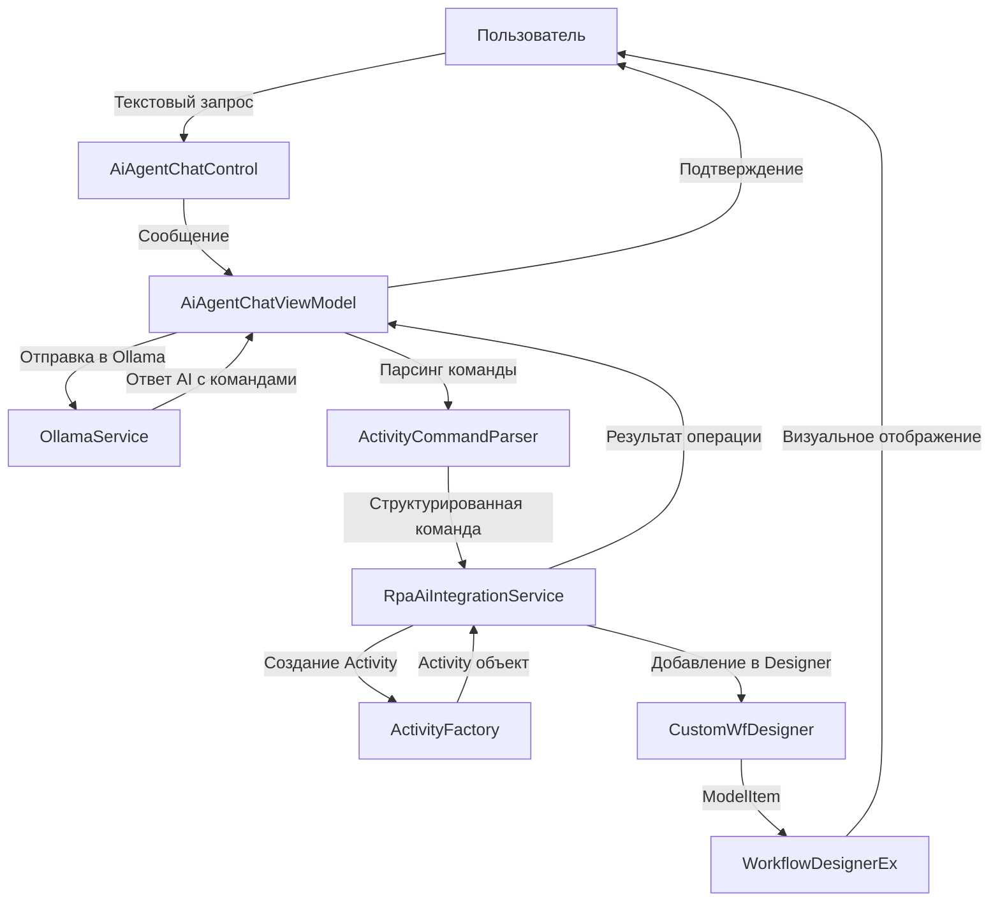
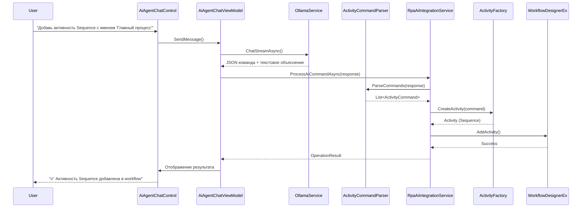

# Архитектура интеграции AI Agent с RPA Workflow Designer

## Обзор

Этот документ описывает архитектуру системы, которая позволяет AI агенту добавлять активности в рабочий процесс на основе текстовых запросов пользователя.

## Текущее состояние

### RPA Studio
- **CustomWfDesigner** - singleton для управления WorkflowDesigner
- **WorkflowDesignerEx** - расширенный WorkflowDesigner с дополнительными свойствами
- **WFToolboxHelper** - строит панель инструментов с доступными активностями
- **LoadActivityToDesignerHelper** - загружает XAML активности в дизайнер
- **ModelTreeManager** - создает ModelItem из Activity объектов для добавления в workflow

### AI Agent
- **AiAgentChatControl** - уже интегрирован в MainView
- **AiAgentChatViewModel** - управляет чатом с AI
- **OllamaService** - взаимодействует с Ollama API
- **JsonConversationStorage** - сохраняет историю диалогов

## Архитектура решения

### Общая схема взаимодействия



### Компоненты системы

## 1. ActivityCommandParser

**Расположение:** `RPA/Services/ActivityCommandParser.cs`

**Назначение:** Парсит ответы AI и извлекает структурированные команды для создания активностей.

**Интерфейс:**
```csharp
public interface IActivityCommandParser
{
    /// <summary>
    /// Парсит текст ответа AI и извлекает команды создания активностей
    /// </summary>
    List<ActivityCommand> ParseCommands(string aiResponse);
    
    /// <summary>
    /// Проверяет, содержит ли текст команды для RPA
    /// </summary>
    bool ContainsRpaCommands(string text);
}

public class ActivityCommand
{
    public string ActivityType { get; set; }  // "Sequence", "If", "While", и т.д.
    public Dictionary<string, object> Parameters { get; set; }
    public string DisplayName { get; set; }
    public List<ActivityCommand> Children { get; set; }  // Для вложенных активностей
}
```

**Формат команд от AI:**
```json
{
  "action": "add_activity",
  "activity": {
    "type": "Sequence",
    "displayName": "Главная последовательность",
    "children": [
      {
        "type": "WriteLine",
        "parameters": {
          "text": "Привет, мир!"
        }
      }
    ]
  }
}
```

## 2. ActivityFactory

**Расположение:** `RPA/Services/ActivityFactory.cs`

**Назначение:** Создает экземпляры Activity на основе типа и параметров.

**Интерфейс:**
```csharp
public interface IActivityFactory
{
    /// <summary>
    /// Создает активность на основе команды
    /// </summary>
    Activity CreateActivity(ActivityCommand command);
    
    /// <summary>
    /// Получает список всех доступных типов активностей
    /// </summary>
    List<ActivityTypeInfo> GetAvailableActivities();
}

public class ActivityTypeInfo
{
    public string TypeName { get; set; }
    public string DisplayName { get; set; }
    public string Description { get; set; }
    public List<ActivityParameter> Parameters { get; set; }
    public string Category { get; set; }
}

public class ActivityParameter
{
    public string Name { get; set; }
    public string Type { get; set; }
    public bool IsRequired { get; set; }
    public object DefaultValue { get; set; }
    public string Description { get; set; }
}
```

**Реализация:**
```csharp
public class ActivityFactory : IActivityFactory
{
    private readonly Dictionary<string, Type> _activityTypes;
    
    public ActivityFactory()
    {
        // Регистрируем все доступные типы активностей
        _activityTypes = new Dictionary<string, Type>(StringComparer.OrdinalIgnoreCase)
        {
            ["Sequence"] = typeof(Sequence),
            ["If"] = typeof(If),
            ["While"] = typeof(While),
            ["DoWhile"] = typeof(DoWhile),
            ["ForEach"] = typeof(ForEach<object>),
            ["WriteLine"] = typeof(WriteLine),
            ["Assign"] = typeof(Assign),
            ["Delay"] = typeof(Delay),
            ["InvokeMethod"] = typeof(InvokeMethod),
            ["TryCatch"] = typeof(TryCatch),
            ["Flowchart"] = typeof(Flowchart),
            // Добавить активности из Activities.Browser и Activities.Flow
        };
    }
    
    public Activity CreateActivity(ActivityCommand command)
    {
        if (!_activityTypes.TryGetValue(command.ActivityType, out Type activityType))
        {
            throw new ArgumentException($"Unknown activity type: {command.ActivityType}");
        }
        
        Activity activity = (Activity)Activator.CreateInstance(activityType);
        
        // Устанавливаем параметры через рефлексию
        SetActivityParameters(activity, command.Parameters);
        
        // Устанавливаем DisplayName если указан
        if (!string.IsNullOrEmpty(command.DisplayName))
        {
            activity.DisplayName = command.DisplayName;
        }
        
        return activity;
    }
}
```

## 3. RpaAiIntegrationService

**Расположение:** `RPA/Services/RpaAiIntegrationService.cs`

**Назначение:** Координирует взаимодействие между AI агентом и RPA Designer.

**Интерфейс:**
```csharp
public interface IRpaAiIntegrationService
{
    /// <summary>
    /// Обрабатывает текстовую команду от AI и выполняет соответствующие действия
    /// </summary>
    Task<OperationResult> ProcessAiCommandAsync(string aiResponse);
    
    /// <summary>
    /// Добавляет активность в активный WorkflowDesigner
    /// </summary>
    OperationResult AddActivityToWorkflow(Activity activity);
    
    /// <summary>
    /// Получает информацию о текущем состоянии workflow
    /// </summary>
    WorkflowInfo GetCurrentWorkflowInfo();
    
    /// <summary>
    /// Генерирует контекст для AI (список доступных активностей)
    /// </summary>
    string GenerateAiContext();
}

public class OperationResult
{
    public bool Success { get; set; }
    public string Message { get; set; }
    public Exception Error { get; set; }
    public object Data { get; set; }
}

public class WorkflowInfo
{
    public string FilePath { get; set; }
    public bool IsLoaded { get; set; }
    public int ActivityCount { get; set; }
    public string RootActivityType { get; set; }
}
```

**Реализация:**
```csharp
public class RpaAiIntegrationService : IRpaAiIntegrationService
{
    private readonly IActivityCommandParser _commandParser;
    private readonly IActivityFactory _activityFactory;
    private readonly CustomWfDesigner _customWfDesigner;
    
    public RpaAiIntegrationService(
        IActivityCommandParser commandParser,
        IActivityFactory activityFactory)
    {
        _commandParser = commandParser;
        _activityFactory = activityFactory;
        _customWfDesigner = CustomWfDesigner.GetInstance();
    }
    
    public async Task<OperationResult> ProcessAiCommandAsync(string aiResponse)
    {
        try
        {
            // Проверяем, содержит ли ответ команды
            if (!_commandParser.ContainsRpaCommands(aiResponse))
            {
                return new OperationResult 
                { 
                    Success = false, 
                    Message = "No RPA commands found in AI response" 
                };
            }
            
            // Парсим команды
            List<ActivityCommand> commands = _commandParser.ParseCommands(aiResponse);
            
            List<OperationResult> results = new List<OperationResult>();
            foreach (ActivityCommand command in commands)
            {
                // Создаем активность
                Activity activity = _activityFactory.CreateActivity(command);
                
                // Добавляем в workflow
                OperationResult result = AddActivityToWorkflow(activity);
                results.Add(result);
            }
            
            return new OperationResult
            {
                Success = results.All(r => r.Success),
                Message = $"Processed {commands.Count} command(s)",
                Data = results
            };
        }
        catch (Exception ex)
        {
            return new OperationResult
            {
                Success = false,
                Message = ex.Message,
                Error = ex
            };
        }
    }
    
    public OperationResult AddActivityToWorkflow(Activity activity)
    {
        try
        {
            WorkflowDesignerEx activeDesigner = _customWfDesigner.ActiveWorkflowDesignerEx;
            
            if (activeDesigner == null)
            {
                return new OperationResult
                {
                    Success = false,
                    Message = "No active workflow designer found"
                };
            }
            
            // Создаем ModelItem из Activity
            ModelTreeManager modelTreeManager = activeDesigner.Context.Services
                .GetService<ModelTreeManager>();
            
            ModelItem modelItem = modelTreeManager.CreateModelItem(null, activity);
            
            // Получаем корневую активность
            ModelItem root = activeDesigner.Context.Items.GetValue<ModelItem>();
            
            // Добавляем в зависимости от типа корневой активности
            if (root.ItemType == typeof(Sequence))
            {
                ModelItemCollection activities = root.Properties["Activities"].Collection;
                activities.Add(modelItem);
            }
            else if (root.ItemType == typeof(Flowchart))
            {
                ModelItemCollection nodes = root.Properties["Nodes"].Collection;
                nodes.Add(modelItem);
            }
            else
            {
                return new OperationResult
                {
                    Success = false,
                    Message = $"Unsupported root activity type: {root.ItemType.Name}"
                };
            }
            
            // Сохраняем изменения
            activeDesigner.Flush();
            
            return new OperationResult
            {
                Success = true,
                Message = $"Successfully added {activity.GetType().Name} to workflow",
                Data = activity
            };
        }
        catch (Exception ex)
        {
            return new OperationResult
            {
                Success = false,
                Message = $"Failed to add activity: {ex.Message}",
                Error = ex
            };
        }
    }
}
```

## 4. Расширение AiAgentChatViewModel

**Модификация:** `AiAgent/ViewModels/AiAgentChatViewModel.cs`

**Изменения:**
1. Добавить зависимость на `IRpaAiIntegrationService`
2. После получения ответа от AI, проверять наличие RPA команд
3. Выполнять команды и отображать результат

```csharp
public class AiAgentChatViewModel : INotifyPropertyChanged
{
    private readonly IRpaAiIntegrationService _rpaIntegration;
    
    // ... существующий код ...
    
    private async Task SendMessageAsync()
    {
        // ... существующий код получения ответа от AI ...
        
        // После получения полного ответа
        assistantMessage.IsStreaming = false;
        CurrentConversation.Messages.Add(assistantMessage);
        
        // НОВОЕ: Обработка RPA команд
        var result = await _rpaIntegration.ProcessAiCommandAsync(assistantMessage.Content);
        
        if (result.Success)
        {
            // Добавляем системное сообщение о выполнении команды
            var systemMessage = new ChatMessage
            {
                Role = "system",
                Content = $"✅ {result.Message}",
                Timestamp = DateTime.Now
            };
            Messages.Add(systemMessage);
        }
        else if (!string.IsNullOrEmpty(result.Message) && 
                 result.Message != "No RPA commands found in AI response")
        {
            // Сообщение об ошибке
            var errorMessage = new ChatMessage
            {
                Role = "system",
                Content = $"❌ {result.Message}",
                Timestamp = DateTime.Now
            };
            Messages.Add(errorMessage);
        }
        
        // ... остальной код ...
    }
}
```

## 5. Система промптов для AI

**Расположение:** `RPA/Prompts/ActivityPrompts.cs`

**Назначение:** Формирует системные промпты для AI, чтобы он понимал контекст RPA и доступные активности.

```csharp
public static class ActivityPrompts
{
    public static string GetSystemPrompt(List<ActivityTypeInfo> availableActivities)
    {
        StringBuilder prompt = new StringBuilder();
        
        prompt.AppendLine("Ты - ассистент RPA (Robotic Process Automation), который помогает пользователям создавать автоматизированные процессы.");
        prompt.AppendLine();
        prompt.AppendLine("## Твои возможности:");
        prompt.AppendLine("1. Понимать запросы пользователя на создание активностей");
        prompt.AppendLine("2. Генерировать JSON команды для добавления активностей в workflow");
        prompt.AppendLine("3. Объяснять, как работают различные активности");
        prompt.AppendLine();
        prompt.AppendLine("## Доступные активности:");
        
        foreach (var activity in availableActivities.GroupBy(a => a.Category))
        {
            prompt.AppendLine($"\n### {activity.Key}:");
            foreach (var act in activity)
            {
                prompt.AppendLine($"- **{act.TypeName}**: {act.Description}");
                if (act.Parameters.Any())
                {
                    prompt.AppendLine("  Параметры:");
                    foreach (var param in act.Parameters)
                    {
                        string required = param.IsRequired ? "(обязательный)" : "(опциональный)";
                        prompt.AppendLine($"    - {param.Name} ({param.Type}) {required}: {param.Description}");
                    }
                }
            }
        }
        
        prompt.AppendLine();
        prompt.AppendLine("## Формат команд:");
        prompt.AppendLine("Когда пользователь просит добавить активность, отвечай в формате JSON:");
        prompt.AppendLine("```json");
        prompt.AppendLine("{");
        prompt.AppendLine("  \"action\": \"add_activity\",");
        prompt.AppendLine("  \"activity\": {");
        prompt.AppendLine("    \"type\": \"ActivityType\",");
        prompt.AppendLine("    \"displayName\": \"Понятное имя\",");
        prompt.AppendLine("    \"parameters\": {");
        prompt.AppendLine("      \"paramName\": \"value\"");
        prompt.AppendLine("    }");
        prompt.AppendLine("  }");
        prompt.AppendLine("}");
        prompt.AppendLine("```");
        prompt.AppendLine();
        prompt.AppendLine("После JSON блока обязательно добавь текстовое пояснение для пользователя.");
        
        return prompt.ToString();
    }
}
```

## 6. Инициализация сервисов

**Модификация:** `AiAgent/Control/AiAgentChatControl.xaml.cs`

```csharp
public partial class AiAgentChatControl : UserControl
{
    public AiAgentChatControl()
    {
        InitializeComponent();
        
        // Создаем сервисы
        var ollamaService = new OllamaService();
        var conversationStorage = new JsonConversationStorage();
        var activityFactory = new ActivityFactory();
        var commandParser = new ActivityCommandParser();
        var rpaIntegration = new RpaAiIntegrationService(commandParser, activityFactory);
        
        // Создаем ViewModel с интеграцией
        var viewModel = new AiAgentChatViewModel(
            ollamaService, 
            conversationStorage,
            rpaIntegration
        );
        
        // Генерируем и устанавливаем системный промпт
        var availableActivities = activityFactory.GetAvailableActivities();
        viewModel.SystemPrompt = ActivityPrompts.GetSystemPrompt(availableActivities);
        
        DataContext = viewModel;
    }
}
```

## Последовательность работы

### Сценарий 1: Пользователь просит добавить Sequence



### Сценарий 2: Добавление вложенных активностей

Пользователь: "Создай Sequence с тремя WriteLine внутри"

AI ответ:
```json
{
  "action": "add_activity",
  "activity": {
    "type": "Sequence",
    "displayName": "Последовательность с WriteLine",
    "children": [
      {
        "type": "WriteLine",
        "parameters": {
          "text": "Первое сообщение"
        }
      },
      {
        "type": "WriteLine",
        "parameters": {
          "text": "Второе сообщение"
        }
      },
      {
        "type": "WriteLine",
        "parameters": {
          "text": "Третье сообщение"
        }
      }
    ]
  }
}
```

Я создал Sequence с тремя активностями WriteLine, которые выведут сообщения по порядку.

## Обработка ошибок

### Типы ошибок и их обработка

1. **Нет активного дизайнера**
   - Сообщение: "Откройте или создайте workflow, прежде чем добавлять активности"
   
2. **Неизвестный тип активности**
   - Сообщение: "Активность '{type}' не найдена. Доступные активности: ..."
   
3. **Некорректные параметры**
   - Сообщение: "Не удалось установить параметр '{param}': {error}"
   
4. **Несовместимый тип корневой активности**
   - Сообщение: "Невозможно добавить активность в {rootType}. Используйте Sequence или Flowchart"

## Расширения и улучшения

### Фаза 2 (будущее)
1. **Редактирование существующих активностей**
   - "Измени текст в WriteLine на 'Новый текст'"
   
2. **Удаление активностей**
   - "Удали последнюю активность"
   
3. **Поиск и замена**
   - "Найди все WriteLine и измени текст на 'Test'"
   
4. **Генерация целых процессов**
   - "Создай процесс для чтения CSV файла и отправки email"
   
5. **Интеллектуальные подсказки**
   - AI анализирует текущий workflow и предлагает улучшения

## Тестирование

### Unit тесты

1. **ActivityCommandParser.Tests**
   - Парсинг простых команд
   - Парсинг вложенных команд
   - Обработка некорректного JSON
   
2. **ActivityFactory.Tests**
   - Создание всех типов активностей
   - Установка параметров
   - Обработка неизвестных типов
   
3. **RpaAiIntegrationService.Tests**
   - Добавление активности в Sequence
   - Добавление активности в Flowchart
   - Обработка ошибок

### Integration тесты

1. Полный цикл: запрос → AI → парсинг → создание → добавление
2. Работа с реальным OllamaService (mock API)
3. Взаимодействие с WorkflowDesigner

## Безопасность

1. **Валидация команд**: Проверка всех команд перед выполнением
2. **Ограничение типов**: Только зарегистрированные типы активностей
3. **Sandbox для параметров**: Безопасная установка значений через рефлексию
4. **Логирование**: Все операции логируются для аудита

## Метрики успеха

1. **Точность парсинга команд**: > 95%
2. **Успешное добавление активностей**: > 90%
3. **Время отклика**: < 5 секунд
4. **Удовлетворенность пользователей**: > 4/5

## Заключение

Эта архитектура обеспечивает:
- Четкое разделение ответственности между компонентами
- Расширяемость для новых типов активностей
- Надежную обработку ошибок
- Простоту тестирования
- Хорошую производительность

Следующий шаг - реализация компонентов согласно этой архитектуре.