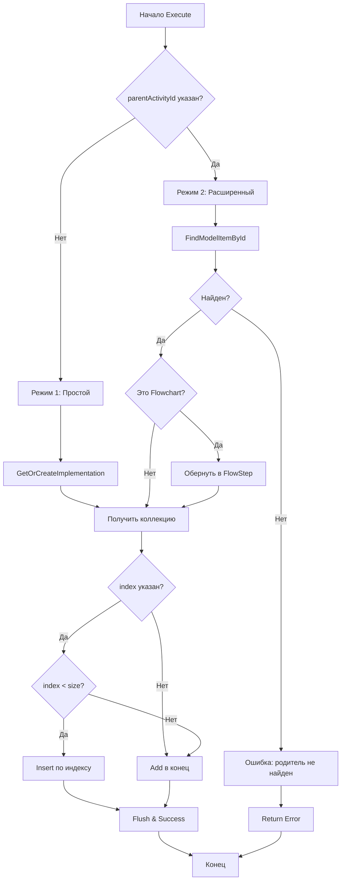

# План усовершенствования AddActivityTool

## Обзор

Усовершенствование инструмента `add_activity` для поддержки добавления активностей в конкретные родительские контейнеры с возможностью указания индекса позиции.

## Текущие ограничения

### Анализ существующей реализации

Текущий [`AddActivityTool.cs`](Mcp/Tools/AddActivityTool.cs:17) имеет следующие ограничения:

1. **Жесткая привязка к корневому Sequence**
   - Всегда добавляет в `root.Properties["Implementation"]`
   - Не работает с вложенными контейнерами

2. **Отсутствие контроля позиции**
   - Всегда добавляет в конец коллекции
   - Нет возможности вставки в определенную позицию

3. **Ограниченная поддержка типов контейнеров**
   - Поддерживается только `Sequence` в Implementation
   - Закомментирован код для `Flowchart`

## Архитектура решения

### Два режима работы

#### Режим 1: Простой (обратная совместимость)
- **Когда**: `parentActivityId` не указан
- **Поведение**: Добавление в `root.Properties["Implementation"]` (текущее поведение)
- **Индекс**: Опциональный параметр
  - Не указан → добавление в конец
  - Указан → вставка по индексу

#### Режим 2: Расширенный (новая функциональность)
- **Когда**: `parentActivityId` указан
- **Поведение**: Добавление в указанную родительскую активность
- **Индекс**: Опциональный параметр
  - Не указан → добавление в конец
  - Указан → вставка по индексу

### Обновленная схема параметров

```csharp
{
    type = "object",
    properties = new
    {
        activityType = new
        {
            type = "string",
            description = "Type of activity to add",
            @enum = new[] { "Sequence", "If", "While", ... }
        },
        parentActivityId = new
        {
            type = "string",
            description = "ID of parent activity to add to (optional). If not specified, adds to root Implementation."
        },
        index = new
        {
            type = "integer",
            description = "Position index to insert activity (optional). 0=start, positive=specific position, not specified=end. If index > collection size, adds to end."
        },
        properties = new { ... },
        arguments = new { ... },
        children = new { ... }
    },
    required = new[] { "activityType" }
}
```

## Технические детали реализации

### 1. Вспомогательные методы

#### FindModelItemById
Поиск ModelItem по ID активности (заимствуется из [`CopyActivityTool.cs`](Mcp/Tools/CopyActivityTool.cs:208)):

```csharp
private ModelItem FindModelItemById(ModelItem root, string id)
{
    if (root == null) return null;
    
    Activity activity = root.GetCurrentValue() as Activity;
    if (activity?.Id == id) return root;
    
    // Рекурсивный поиск в свойствах и коллекциях
    foreach (ModelProperty property in root.Properties)
    {
        if (property.Value != null)
        {
            ModelItem found = FindModelItemById(property.Value, id);
            if (found != null) return found;
        }
        
        if (property.Collection != null)
        {
            foreach (ModelItem item in property.Collection)
            {
                ModelItem found = FindModelItemById(item, id);
                if (found != null) return found;
            }
        }
    }
    
    return null;
}
```

#### GetActivitiesCollection
Получение коллекции активностей из контейнера (из [`CopyActivityTool.cs`](Mcp/Tools/CopyActivityTool.cs:197)):

```csharp
private ModelItemCollection GetActivitiesCollection(ModelItem parent)
{
    if (parent == null) return null;
    
    // Проверяем различные типы коллекций
    if (parent.Properties["Activities"]?.Collection != null)
        return parent.Properties["Activities"].Collection;  // Sequence, Parallel
    
    if (parent.Properties["Branches"]?.Collection != null)
        return parent.Properties["Branches"].Collection;     // Parallel branches
    
    if (parent.Properties["Nodes"]?.Collection != null)
        return parent.Properties["Nodes"].Collection;        // Flowchart
    
    return null;
}
```

#### AddActivityAtIndex
Новый метод для вставки активности по индексу:

```csharp
private bool AddActivityAtIndex(ModelItemCollection collection, ModelItem modelItem, int? index)
{
    if (collection == null) return false;
    
    try
    {
        if (!index.HasValue || index.Value < 0 || index.Value >= collection.Count)
        {
            // Добавление в конец
            collection.Add(modelItem);
        }
        else
        {
            // Вставка по индексу
            collection.Insert(index.Value, modelItem);
        }
        return true;
    }
    catch
    {
        return false;
    }
}
```

### 2. Обновленный метод AddActivityToDesigner

```csharp
private bool AddActivityToDesigner(Activity activity, string parentActivityId, int? index)
{
    try
    {
        WorkflowDesignerEx designer = _designer.ActiveWorkflowDesignerEx;
        if (designer == null) return false;
        
        ModelService modelService = designer.Context.Services.GetService<ModelService>();
        ModelTreeManager modelTreeManager = designer.Context.Services.GetService<ModelTreeManager>();
        
        if (modelService?.Root == null || modelTreeManager == null) return false;
        
        // Создаем ModelItem для новой активности
        ModelItem modelItem = modelTreeManager.CreateModelItem(null, activity);
        ModelItem root = modelService.Root;
        
        // Определяем целевой контейнер
        ModelItem targetContainer = null;
        
        if (string.IsNullOrEmpty(parentActivityId))
        {
            // РЕЖИМ 1: Простой - добавление в Implementation
            targetContainer = GetOrCreateImplementation(root, modelTreeManager);
        }
        else
        {
            // РЕЖИМ 2: Расширенный - добавление в указанный родитель
            targetContainer = FindModelItemById(root, parentActivityId);
            
            if (targetContainer == null)
            {
                _designer.Log($"Parent activity with id '{parentActivityId}' not found");
                return false;
            }
        }
        
        // Получаем коллекцию активностей
        ModelItemCollection collection = GetActivitiesCollection(targetContainer);
        
        if (collection == null)
        {
            _designer.Log($"Target container does not support child activities");
            return false;
        }
        
        // Добавляем активность с учетом индекса
        bool success = false;
        ((MainView)_designer.ViewModel.View).Dispatcher.Invoke(() =>
        {
            success = AddActivityAtIndex(collection, modelItem, index);
            if (success)
            {
                designer.Flush();
            }
        });
        
        return success;
    }
    catch (Exception ex)
    {
        _designer.Log($"Failed to add to designer: {ex.Message}");
        return false;
    }
}
```

#### GetOrCreateImplementation
Вспомогательный метод для работы с Implementation:

```csharp
private ModelItem GetOrCreateImplementation(ModelItem root, ModelTreeManager modelTreeManager)
{
    if (root.ItemType != typeof(ActivityBuilder))
    {
        throw new Exception($"Unexpected root type: {root.ItemType.Name}");
    }
    
    ModelItem implementation = root.Properties["Implementation"].Value;
    
    if (implementation == null)
    {
        // Создаем новый Sequence если Implementation пустой
        ModelItem sequenceItem = modelTreeManager.CreateModelItem(null, new Sequence());
        
        ((MainView)_designer.ViewModel.View).Dispatcher.Invoke(() =>
        {
            root.Properties["Implementation"].SetValue(sequenceItem);
        });
        
        return sequenceItem;
    }
    
    return implementation;
}
```

### 3. Обновленный метод Execute

```csharp
public override async Task<McpToolResult> Execute(object arguments)
{
    return await Task.Run(() =>
    {
        try
        {
            if (_designer.ActiveWorkflowDesignerEx == null)
            {
                return Error("No active workflow designer. Please open or create a workflow first.");
            }
            
            JObject args = JObject.FromObject(arguments);
            string activityType = args["activityType"]?.ToString();
            string parentActivityId = args["parentActivityId"]?.ToString();
            int? index = args["index"]?.ToObject<int?>();
            
            if (string.IsNullOrEmpty(activityType))
            {
                return Error("activityType is required");
            }
            
            // Валидация индекса
            if (index.HasValue && index.Value < 0)
            {
                return Error("index must be non-negative");
            }
            
            JObject properties = args["properties"] as JObject;
            JObject activityArguments = args["arguments"] as JObject;
            JArray children = args["children"] as JArray;
            
            // Создаем активность
            Activity activity = CreateActivity(activityType, properties, activityArguments, children);
            
            if (activity == null)
            {
                return Error($"Failed to create activity of type '{activityType}'");
            }
            
            // Добавляем в дизайнер с учетом parentActivityId и index
            bool added = AddActivityToDesigner(activity, parentActivityId, index);
            
            if (!added)
            {
                return Error($"Failed to add activity '{activityType}' to designer");
            }
            
            return Success(new
            {
                message = $"Activity '{activityType}' successfully added to workflow",
                activityType,
                displayName = activity.DisplayName,
                id = activity.Id,
                parentActivityId = string.IsNullOrEmpty(parentActivityId) ? "root.Implementation" : parentActivityId,
                position = index.HasValue ? $"index {index.Value}" : "end"
            });
        }
        catch (Exception ex)
        {
            return Error($"Failed to add activity: {ex.Message}");
        }
    });
}
```

## Поддержка специальных контейнеров

### Flowchart
Для Flowchart требуется создание `FlowStep`:

```csharp
private ModelItem WrapInFlowStep(Activity activity, ModelTreeManager modelTreeManager)
{
    FlowStep flowStep = new FlowStep { Action = activity };
    return modelTreeManager.CreateModelItem(null, flowStep);
}
```

Интеграция в `AddActivityToDesigner`:

```csharp
// После создания modelItem
if (targetContainer.ItemType == typeof(Flowchart))
{
    modelItem = WrapInFlowStep(activity, modelTreeManager);
}
```

### If, TryCatch, While (специальные свойства)

Для активностей с именованными свойствами (Then/Else у If, Try/Catch у TryCatch) требуется явное указание:

**Вариант 1**: Расширить `parentActivityId` для указания свойства
```
parentActivityId: "activity-123.Then"  // для If.Then
parentActivityId: "activity-456.Try"   // для TryCatch.Try
```

**Вариант 2**: Добавить отдельный параметр `propertyName`
```json
{
    "parentActivityId": "activity-123",
    "propertyName": "Then"
}
```

Рекомендуется **Вариант 2** для ясности.

## Диаграмма потока выполнения



## Примеры использования

### Пример 1: Простое добавление (обратная совместимость)
```json
{
    "activityType": "WriteLine",
    "properties": {
        "Text": "Hello World"
    }
}
```
**Результат**: Добавлено в конец `root.Implementation`

### Пример 2: Добавление в начало
```json
{
    "activityType": "WriteLine",
    "properties": {
        "Text": "First activity"
    },
    "index": 0
}
```
**Результат**: Вставлено в начало `root.Implementation`

### Пример 3: Добавление в конкретную Sequence
```json
{
    "activityType": "WriteLine",
    "properties": {
        "Text": "Inside nested sequence"
    },
    "parentActivityId": "sequence-456"
}
```
**Результат**: Добавлено в конец Sequence с ID "sequence-456"

### Пример 4: Вставка в позицию внутри контейнера
```json
{
    "activityType": "Delay",
    "properties": {
        "Duration": "00:00:05"
    },
    "parentActivityId": "sequence-789",
    "index": 2
}
```
**Результат**: Вставлено в позицию 2 внутри Sequence "sequence-789"

### Пример 5: Добавление в Flowchart
```json
{
    "activityType": "WriteLine",
    "properties": {
        "Text": "In flowchart"
    },
    "parentActivityId": "flowchart-123"
}
```
**Результат**: Обернуто в FlowStep и добавлено в Flowchart

## Обработка ошибок

### Возможные ошибки и их обработка

| Ошибка | Сценарий | Обработка |
|--------|----------|-----------|
| Parent not found | `parentActivityId` не существует | Вернуть ошибку с перечислением доступных ID |
| Invalid index | `index < 0` | Вернуть ошибку валидации |
| No collection | Контейнер не поддерживает дочерние элементы | Вернуть ошибку с типом контейнера |
| Index out of range | `index > collection.Count` | Добавить в конец (мягкая обработка) |

## Тестовые сценарии

### Базовые сценарии
1. ✅ Добавление без параметров (в конец Implementation)
2. ✅ Добавление с index=0 (в начало Implementation)
3. ✅ Добавление с index в середину
4. ✅ Добавление с parentActivityId (в конкретный контейнер)
5. ✅ Добавление с parentActivityId и index

### Граничные случаи
6. ✅ index больше размера коллекции
7. ✅ parentActivityId несуществующей активности
8. ✅ Пустой Implementation (автосоздание Sequence)
9. ✅ Добавление в Flowchart (автообертка в FlowStep)
10. ✅ Добавление в Parallel (множественные ветки)

### Специальные контейнеры
11. ✅ If.Then/If.Else
12. ✅ TryCatch.Try
13. ✅ While.Body
14. ✅ DoWhile.Body

## План реализации

1. ✅ Добавить вспомогательные методы (FindModelItemById, GetActivitiesCollection)
2. ✅ Создать метод AddActivityAtIndex
3. ✅ Создать метод GetOrCreateImplementation
4. ✅ Обновить схему инструмента (добавить parentActivityId и index)
5. ✅ Обновить метод Execute (парсинг новых параметров)
6. ✅ Обновить метод AddActivityToDesigner (два режима работы)
7. ✅ Добавить поддержку Flowchart (WrapInFlowStep)
8. ✅ Добавить валидацию и обработку ошибок
9. ✅ Написать unit-тесты
10. ✅ Обновить документацию MCP_Workflow_Tools_Guide.md

## Обратная совместимость

Изменения полностью обратно совместимы:
- Существующие вызовы без `parentActivityId` и `index` работают как прежде
- Новые параметры опциональные
- Поведение по умолчанию не изменяется

## Производительность

- Поиск по ID: O(n) где n - количество активностей
- Вставка по индексу: O(1) для ModelItemCollection
- Память: Минимальное увеличение (новые параметры)

## Заключение

Данное усовершенствование значительно расширяет возможности `add_activity` инструмента, позволяя AI-агентам:
- Добавлять активности в любое место workflow
- Контролировать порядок активностей
- Работать со сложными вложенными структурами
- Сохранять обратную совместимость с текущими интеграциями