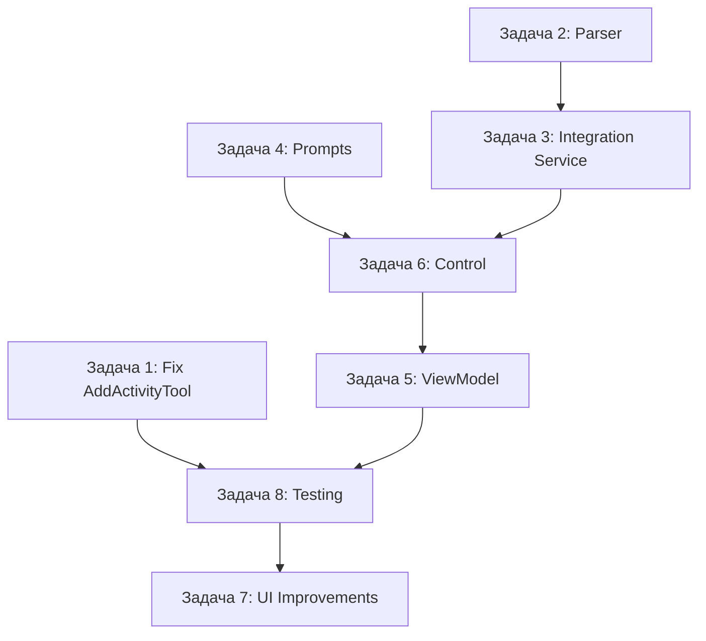

# Задачи для режима Code: Интеграция AI с RPA через текстовые запросы

## Статус проекта

**Текущее состояние:**
- ✅ MCP сервер реализован ([`RpaMcpServer.cs`](../Mcp/RpaMcpServer.cs))
- ✅ MCP инструменты созданы (AddActivityTool, ListActivitiesTool и др.)
- ✅ AiAgentChatControl интегрирован в MainView
- ❌ **Критическая проблема:** [`AddActivityTool.Execute()`](../Mcp/Tools/AddActivityTool.cs:72) создает Activity, но НЕ добавляет в WorkflowDesigner
- ❌ AiAgentChatViewModel не интегрирован с MCP
- ❌ Нет парсинга команд от AI
- ❌ Нет системных промптов

---

## 🔴 КРИТИЧЕСКАЯ ЗАДАЧА #1: Исправить AddActivityTool

**Приоритет:** КРИТИЧЕСКИЙ  
**Файл:** [`Mcp/Tools/AddActivityTool.cs`](../Mcp/Tools/AddActivityTool.cs)  
**Проблема:** Строки 98-114 создают Activity, но не добавляют в Designer

### Что нужно сделать:

1. **Добавить метод для вставки Activity в WorkflowDesigner**
   - Использовать ModelTreeManager для создания ModelItem
   - Определить целевой контейнер (Sequence, Flowchart и т.д.)
   - Вставить ModelItem в нужное место

### Пример реализации:

```csharp
// После строки 106 в AddActivityTool.cs
private bool AddActivityToDesigner(Activity activity)
{
    try
    {
        var designer = _designer.ActiveWorkflowDesignerEx;
        if (designer == null) return false;

        // Получаем ModelTreeManager
        var modelTreeManager = designer.Context.Services.GetService<ModelTreeManager>();
        if (modelTreeManager == null) return false;

        // Создаем ModelItem из Activity
        var modelItem = modelTreeManager.CreateModelItem(null, activity);

        // Получаем корневой элемент
        var root = designer.Context.Items.GetValue<ModelItem>();
        
        // Добавляем в зависимости от типа корня
        if (root.ItemType == typeof(Sequence))
        {
            var activities = root.Properties["Activities"].Collection;
            activities.Add(modelItem);
        }
        else if (root.ItemType == typeof(Flowchart))
        {
            var nodes = root.Properties["Nodes"].Collection;
            // Для Flowchart нужно создать FlowStep
            var flowStep = new FlowStep { Action = activity };
            var flowStepModelItem = modelTreeManager.CreateModelItem(null, flowStep);
            nodes.Add(flowStepModelItem);
        }
        else
        {
            _designer.Log($"Unsupported root type: {root.ItemType.Name}");
            return false;
        }

        // Сохраняем изменения
        designer.Flush();
        return true;
    }
    catch (Exception ex)
    {
        _designer.Log($"Failed to add to designer: {ex.Message}");
        return false;
    }
}
```

2. **Вызвать метод в Execute()**
   - Заменить строки 106-114
   - Добавить проверку успешности

```csharp
// Заменить строки 106-114
bool added = AddActivityToDesigner(activity);

if (!added)
{
    return Error($"Failed to add activity '{activityType}' to designer");
}

return Success(new
{
    message = $"Activity '{activityType}' successfully added to workflow",
    activityType,
    displayName = activity.DisplayName,
    id = activity.Id
});
```

### Необходимые using:
```csharp
using System.Activities.Presentation.Model;
using System.Activities.Presentation.Services;
using System.Activities.Statements;
```

### Критерии приемки:
- [ ] Activity добавляется в визуальный Designer
- [ ] Работает для Sequence и Flowchart
- [ ] Flush() сохраняет изменения
- [ ] Возвращается корректный статус успеха/ошибки

---

## 🟡 ЗАДАЧА #2: Создать ActivityCommandParser

**Приоритет:** Высокий  
**Новый файл:** `AiAgent/Services/ActivityCommandParser.cs`  
**Зависимости:** Newtonsoft.Json (уже есть)

### Цель:
Парсить JSON команды из ответов AI и преобразовывать в вызовы MCP инструментов.

### Интерфейс:

```csharp
namespace RPA.AiAgent.Services
{
    public interface IActivityCommandParser
    {
        /// <summary>
        /// Парсит ответ AI и извлекает команды для MCP
        /// </summary>
        List<McpCommand> ParseCommands(string aiResponse);
        
        /// <summary>
        /// Проверяет, содержит ли текст команды
        /// </summary>
        bool ContainsCommands(string text);
    }

    public class McpCommand
    {
        public string ToolName { get; set; }
        public object Arguments { get; set; }
        public string Description { get; set; }
    }
}
```

### Реализация:

```csharp
using System;
using System.Collections.Generic;
using System.Text.RegularExpressions;
using Newtonsoft.Json;
using Newtonsoft.Json.Linq;

namespace RPA.AiAgent.Services
{
    public class ActivityCommandParser : IActivityCommandParser
    {
        private static readonly Regex JsonBlockRegex = new Regex(
            @"```json\s*(\{[\s\S]*?\})\s*```",
            RegexOptions.Multiline
        );

        public bool ContainsCommands(string text)
        {
            if (string.IsNullOrWhiteSpace(text))
                return false;

            return JsonBlockRegex.IsMatch(text) || 
                   text.Contains("\"action\"") || 
                   text.Contains("\"activityType\"");
        }

        public List<McpCommand> ParseCommands(string aiResponse)
        {
            var commands = new List<McpCommand>();

            if (string.IsNullOrWhiteSpace(aiResponse))
                return commands;

            // Ищем JSON блоки в markdown
            var matches = JsonBlockRegex.Matches(aiResponse);
            
            foreach (Match match in matches)
            {
                try
                {
                    string jsonContent = match.Groups[1].Value;
                    var command = ParseSingleCommand(jsonContent);
                    if (command != null)
                    {
                        commands.Add(command);
                    }
                }
                catch (Exception ex)
                {
                    // Логируем, но продолжаем
                    Console.WriteLine($"Failed to parse command: {ex.Message}");
                }
            }

            // Если не нашли markdown блоки, пробуем найти JSON напрямую
            if (commands.Count == 0)
            {
                try
                {
                    var command = ParseSingleCommand(aiResponse);
                    if (command != null)
                    {
                        commands.Add(command);
                    }
                }
                catch { }
            }

            return commands;
        }

        private McpCommand ParseSingleCommand(string json)
        {
            var jObject = JObject.Parse(json);
            
            // Проверяем наличие action
            string action = jObject["action"]?.ToString();
            
            if (action == "add_activity")
            {
                var activity = jObject["activity"];
                if (activity != null)
                {
                    return new McpCommand
                    {
                        ToolName = "add_activity",
                        Arguments = new
                        {
                            activityType = activity["type"]?.ToString(),
                            displayName = activity["displayName"]?.ToString(),
                            parameters = activity["parameters"],
                            children = activity["children"]
                        },
                        Description = $"Add {activity["type"]} activity"
                    };
                }
            }

            return null;
        }
    }
}
```

### Критерии приемки:
- [ ] Парсит JSON из markdown блоков
- [ ] Парсит прямой JSON
- [ ] Извлекает команды add_activity
- [ ] Обрабатывает ошибки парсинга
- [ ] ContainsCommands() корректно определяет наличие команд

---

## 🟡 ЗАДАЧА #3: Создать RpaAiIntegrationService

**Приоритет:** Высокий  
**Новый файл:** `AiAgent/Services/RpaAiIntegrationService.cs`  
**Зависимости:** ActivityCommandParser, RpaMcpServer

### Цель:
Связать AI чат с MCP сервером для выполнения команд.

### Интерфейс:

```csharp
namespace RPA.AiAgent.Services
{
    public interface IRpaAiIntegrationService
    {
        /// <summary>
        /// Обрабатывает ответ AI и выполняет команды
        /// </summary>
        Task<OperationResult> ProcessAiResponseAsync(string aiResponse);
        
        /// <summary>
        /// Генерирует контекст для AI (доступные инструменты)
        /// </summary>
        Task<string> GenerateAiContextAsync();
    }

    public class OperationResult
    {
        public bool Success { get; set; }
        public string Message { get; set; }
        public List<string> ExecutedCommands { get; set; }
        public List<string> Errors { get; set; }
    }
}
```

### Реализация:

```csharp
using System;
using System.Collections.Generic;
using System.Linq;
using System.Text;
using System.Threading.Tasks;
using RPA.Mcp;

namespace RPA.AiAgent.Services
{
    public class RpaAiIntegrationService : IRpaAiIntegrationService
    {
        private readonly IActivityCommandParser _parser;
        private readonly IMcpServer _mcpServer;

        public RpaAiIntegrationService(
            IActivityCommandParser parser,
            IMcpServer mcpServer)
        {
            _parser = parser;
            _mcpServer = mcpServer;
        }

        public async Task<OperationResult> ProcessAiResponseAsync(string aiResponse)
        {
            var result = new OperationResult
            {
                Success = true,
                ExecutedCommands = new List<string>(),
                Errors = new List<string>()
            };

            try
            {
                // Проверяем наличие команд
                if (!_parser.ContainsCommands(aiResponse))
                {
                    result.Success = false;
                    result.Message = "No commands found in AI response";
                    return result;
                }

                // Парсим команды
                var commands = _parser.ParseCommands(aiResponse);
                
                if (commands.Count == 0)
                {
                    result.Success = false;
                    result.Message = "Failed to parse commands from AI response";
                    return result;
                }

                // Выполняем каждую команду
                foreach (var command in commands)
                {
                    try
                    {
                        var toolResult = await _mcpServer.CallTool(
                            command.ToolName, 
                            command.Arguments
                        );

                        if (toolResult.Success)
                        {
                            result.ExecutedCommands.Add(
                                $"{command.ToolName}: {toolResult.Message}"
                            );
                        }
                        else
                        {
                            result.Errors.Add(
                                $"{command.ToolName} failed: {toolResult.Error}"
                            );
                            result.Success = false;
                        }
                    }
                    catch (Exception ex)
                    {
                        result.Errors.Add(
                            $"Error executing {command.ToolName}: {ex.Message}"
                        );
                        result.Success = false;
                    }
                }

                // Формируем итоговое сообщение
                if (result.Success)
                {
                    result.Message = $"Successfully executed {commands.Count} command(s)";
                }
                else
                {
                    result.Message = $"Executed {result.ExecutedCommands.Count} command(s) with {result.Errors.Count} error(s)";
                }

                return result;
            }
            catch (Exception ex)
            {
                result.Success = false;
                result.Message = $"Failed to process AI response: {ex.Message}";
                result.Errors.Add(ex.ToString());
                return result;
            }
        }

        public async Task<string> GenerateAiContextAsync()
        {
            try
            {
                var tools = await _mcpServer.ListTools();
                var sb = new StringBuilder();

                sb.AppendLine("## Available RPA Commands");
                sb.AppendLine();
                sb.AppendLine("You can control the RPA workflow designer using JSON commands.");
                sb.AppendLine("Wrap your commands in markdown code blocks like this:");
                sb.AppendLine();
                sb.AppendLine("```json");
                sb.AppendLine("{");
                sb.AppendLine("  \"action\": \"add_activity\",");
                sb.AppendLine("  \"activity\": {");
                sb.AppendLine("    \"type\": \"Sequence\",");
                sb.AppendLine("    \"displayName\": \"My Sequence\"");
                sb.AppendLine("  }");
                sb.AppendLine("}");
                sb.AppendLine("```");
                sb.AppendLine();
                sb.AppendLine("### Available Tools:");
                sb.AppendLine();

                foreach (var tool in tools)
                {
                    sb.AppendLine($"**{tool.Name}**");
                    sb.AppendLine($"- {tool.Description}");
                    sb.AppendLine();
                }

                return sb.ToString();
            }
            catch (Exception ex)
            {
                return $"Failed to generate AI context: {ex.Message}";
            }
        }
    }
}
```

### Критерии приемки:
- [ ] Парсит и выполняет команды из AI ответа
- [ ] Возвращает детальный результат с ошибками
- [ ] GenerateAiContextAsync() создает полезный контекст для AI
- [ ] Обрабатывает множественные команды

---

## 🟡 ЗАДАЧА #4: Создать ActivityPrompts

**Приоритет:** Средний  
**Новый файл:** `AiAgent/Prompts/ActivityPrompts.cs`

### Цель:
Генерировать системные промпты для AI с описанием доступных активностей.

### Реализация:

```csharp
using System.Text;

namespace RPA.AiAgent.Prompts
{
    public static class ActivityPrompts
    {
        public static string GetSystemPrompt()
        {
            var sb = new StringBuilder();

            sb.AppendLine("# RPA Workflow Assistant");
            sb.AppendLine();
            sb.AppendLine("You are an AI assistant for RPA Studio, a workflow automation tool.");
            sb.AppendLine("You help users create automated workflows by adding activities to the designer.");
            sb.AppendLine();
            sb.AppendLine("## Your Capabilities");
            sb.AppendLine();
            sb.AppendLine("When users ask to add activities, respond with JSON commands in markdown code blocks:");
            sb.AppendLine();
            sb.AppendLine("```json");
            sb.AppendLine("{");
            sb.AppendLine("  \"action\": \"add_activity\",");
            sb.AppendLine("  \"activity\": {");
            sb.AppendLine("    \"type\": \"ActivityType\",");
            sb.AppendLine("    \"displayName\": \"Human-readable name\",");
            sb.AppendLine("    \"parameters\": {");
            sb.AppendLine("      \"parameterName\": \"value\"");
            sb.AppendLine("    }");
            sb.AppendLine("  }");
            sb.AppendLine("}");
            sb.AppendLine("```");
            sb.AppendLine();
            sb.AppendLine("After the JSON command, provide a friendly explanation in Russian.");
            sb.AppendLine();
            sb.AppendLine("## Available Activity Types");
            sb.AppendLine();
            sb.AppendLine("### Control Flow");
            sb.AppendLine("- **Sequence**: Sequential execution of activities");
            sb.AppendLine("- **If**: Conditional branching (Then/Else)");
            sb.AppendLine("- **While**: Loop with pre-condition");
            sb.AppendLine("- **DoWhile**: Loop with post-condition");
            sb.AppendLine("- **ForEach**: Iterate over collection");
            sb.AppendLine("- **Parallel**: Execute branches in parallel");
            sb.AppendLine("- **TryCatch**: Exception handling");
            sb.AppendLine();
            sb.AppendLine("### Primitive Activities");
            sb.AppendLine("- **WriteLine**: Output text to console");
            sb.AppendLine("  - Parameters: `text` (string)");
            sb.AppendLine("- **Delay**: Wait for specified duration");
            sb.AppendLine("  - Parameters: `duration` (TimeSpan, e.g., \"00:00:05\")");
            sb.AppendLine("- **Assign**: Assign value to variable");
            sb.AppendLine();
            sb.AppendLine("### Design Patterns");
            sb.AppendLine("- **Flowchart**: Visual flow-based workflow");
            sb.AppendLine();
            sb.AppendLine("## Examples");
            sb.AppendLine();
            sb.AppendLine("**User**: Add a sequence");
            sb.AppendLine("**You**: ");
            sb.AppendLine("```json");
            sb.AppendLine("{");
            sb.AppendLine("  \"action\": \"add_activity\",");
            sb.AppendLine("  \"activity\": {");
            sb.AppendLine("    \"type\": \"Sequence\",");
            sb.AppendLine("    \"displayName\": \"Main Sequence\"");
            sb.AppendLine("  }");
            sb.AppendLine("}");
            sb.AppendLine("```");
            sb.AppendLine("Я добавил активность Sequence с именем \"Main Sequence\" в workflow.");
            sb.AppendLine();
            sb.AppendLine("## Important Rules");
            sb.AppendLine("1. Always wrap JSON commands in markdown code blocks");
            sb.AppendLine("2. Use correct activity type names (case-sensitive)");
            sb.AppendLine("3. Provide Russian explanations after JSON");
            sb.AppendLine("4. Be concise and helpful");

            return sb.ToString();
        }
    }
}
```

### Критерии приемки:
- [ ] Создает понятный системный промпт
- [ ] Включает примеры команд
- [ ] Описывает все основные типы активностей
- [ ] Промпт на английском, но указывает отвечать на русском

---

## 🟠 ЗАДАЧА #5: Интегрировать в AiAgentChatViewModel

**Приоритет:** Высокий  
**Файл:** [`AiAgent/ViewModels/AiAgentChatViewModel.cs`](../AiAgent/ViewModels/AiAgentChatViewModel.cs)

### Изменения:

1. **Добавить зависимость** (после строки 22):

```csharp
private readonly IRpaAiIntegrationService _rpaIntegration;
```

2. **Обновить конструктор** (строка 30):

```csharp
public AiAgentChatViewModel(
    IOllamaService ollamaService, 
    IConversationStorage conversationStorage,
    IRpaAiIntegrationService rpaIntegration)
{
    _ollamaService = ollamaService ?? throw new ArgumentNullException(nameof(ollamaService));
    _conversationStorage = conversationStorage ?? throw new ArgumentNullException(nameof(conversationStorage));
    _rpaIntegration = rpaIntegration ?? throw new ArgumentNullException(nameof(rpaIntegration));
    
    // ... rest of constructor
}
```

3. **Добавить свойство SystemPrompt** (после строки 133):

```csharp
private string _systemPrompt;

/// <summary>
/// Системный промпт для AI
/// </summary>
public string SystemPrompt
{
    get => _systemPrompt;
    set
    {
        if (_systemPrompt != value)
        {
            _systemPrompt = value;
            OnPropertyChanged(nameof(SystemPrompt));
        }
    }
}
```

4. **Модифицировать SendMessageAsync()** (после строки 254):

```csharp
// После строки 254 (assistantMessage.IsStreaming = false;)
assistantMessage.IsStreaming = false;
CurrentConversation.Messages.Add(assistantMessage);

// НОВОЕ: Обработка RPA команд
try
{
    var result = await _rpaIntegration.ProcessAiResponseAsync(assistantMessage.Content);
    
    if (result.Success && result.ExecutedCommands.Count > 0)
    {
        // Добавляем системное сообщение об успехе
        var systemMessage = new ChatMessage
        {
            Role = "system",
            Content = $"✅ {result.Message}\n{string.Join("\n", result.ExecutedCommands)}",
            Timestamp = DateTime.Now
        };
        Messages.Add(systemMessage);
    }
    else if (result.Errors.Count > 0)
    {
        // Сообщение об ошибках
        var errorMessage = new ChatMessage
        {
            Role = "system",
            Content = $"❌ {result.Message}\n{string.Join("\n", result.Errors)}",
            Timestamp = DateTime.Now
        };
        Messages.Add(errorMessage);
    }
}
catch (Exception ex)
{
    var errorMessage = new ChatMessage
    {
        Role = "system",
        Content = $"❌ Ошибка выполнения команды: {ex.Message}",
        Timestamp = DateTime.Now
    };
    Messages.Add(errorMessage);
}

StatusMessage = "Ответ получен";
```

5. **Использовать SystemPrompt в запросах к Ollama**

Нужно модифицировать [`OllamaService.cs`](../AiAgent/Services/OllamaService.cs) для поддержки system message, или добавить его как первое сообщение в историю.

### Критерии приемки:
- [ ] ViewModel принимает RpaAiIntegrationService
- [ ] SystemPrompt устанавливается и используется
- [ ] После ответа AI выполняются команды
- [ ] Результаты отображаются в UI

---

## 🟠 ЗАДАЧА #6: Обновить AiAgentChatControl.xaml.cs

**Приоритет:** Средний  
**Файл:** `AiAgent/Control/AiAgentChatControl.xaml.cs`

### Изменения в конструкторе:

```csharp
public AiAgentChatControl()
{
    InitializeComponent();
    
    // Создаем сервисы
    var ollamaService = new OllamaService();
    var conversationStorage = new JsonConversationStorage();
    
    // Создаем MCP инфраструктуру
    var mcpServer = new RpaMcpServer();
    var commandParser = new ActivityCommandParser();
    var rpaIntegration = new RpaAiIntegrationService(commandParser, mcpServer);
    
    // Создаем ViewModel
    var viewModel = new AiAgentChatViewModel(
        ollamaService, 
        conversationStorage,
        rpaIntegration
    );
    
    // Устанавливаем системный промпт
    viewModel.SystemPrompt = ActivityPrompts.GetSystemPrompt();
    
    DataContext = viewModel;
}
```

### Необходимые using:

```csharp
using RPA.AiAgent.Services;
using RPA.AiAgent.Prompts;
using RPA.Mcp;
```

### Критерии приемки:
- [ ] Все сервисы создаются и связываются
- [ ] SystemPrompt устанавливается
- [ ] ViewModel корректно инициализируется

---

## 🟢 ЗАДАЧА #7: Добавить визуальные улучшения UI

**Приоритет:** Низкий (опционально)  
**Файл:** `AiAgent/Control/AiAgentChatControl.xaml`

### Возможные улучшения:

1. **Стилизация системных сообщений**
```xml
<DataTemplate x:Key="SystemMessageTemplate">
    <Border Background="#FFF3CD" CornerRadius="5" Padding="10" Margin="5">
        <TextBlock Text="{Binding Content}" 
                   Foreground="#856404"
                   TextWrapping="Wrap"/>
    </Border>
</DataTemplate>
```

2. **Индикатор выполнения команды**
3. **Кнопка "Показать доступные активности"**

---

## 🔵 ЗАДАЧА #8: Тестирование

**Приоритет:** Высокий

### Сценарии для тестирования:

1. **Базовый тест**: "Добавь Sequence"
   - [ ] AI генерирует JSON команду
   - [ ] Команда парсится
   - [ ] Activity добавляется в Designer
   - [ ] Результат отображается в чате

2. **Тест с параметрами**: "Добавь WriteLine с текстом 'Hello'"
   - [ ] Параметры корректно передаются
   - [ ] Activity создается с нужным текстом

3. **Тест вложенных активностей**: "Создай Sequence с тремя WriteLine"
   - [ ] Children обрабатываются
   - [ ] Все активности добавляются

4. **Тест ошибок**: Команда без открытого Designer
   - [ ] Ошибка корректно обрабатывается
   - [ ] Понятное сообщение в UI

5. **Тест Flowchart**: "Добавь Flowchart"
   - [ ] Работает с разными типами root activity

---

## Порядок выполнения задач

### Фаза 1: Критические исправления (День 1)
1. ✅ Задача #1: Исправить AddActivityTool ← **НАЧАТЬ ЗДЕСЬ**

### Фаза 2: Базовая инфраструктура (День 1-2)
2. ✅ Задача #2: ActivityCommandParser
3. ✅ Задача #3: RpaAiIntegrationService
4. ✅ Задача #4: ActivityPrompts

### Фаза 3: Интеграция (День 2-3)
5. ✅ Задача #5: AiAgentChatViewModel
6. ✅ Задача #6: AiAgentChatControl

### Фаза 4: Тестирование и улучшения (День 3-4)
7. ✅ Задача #8: Тестирование
8. ⚪ Задача #7: UI улучшения (опционально)

---

## Зависимости между задачами



---

## Критерии успеха проекта

- [ ] Пользователь пишет "Добавь Sequence" → активность появляется в Designer
- [ ] AI понимает русские и английские команды
- [ ] Параметры активностей корректно устанавливаются
- [ ] Ошибки обрабатываются с понятными сообщениями
- [ ] Результаты выполнения видны в чате
- [ ] Поддержка минимум 5 типов активностей

---

## Следующие шаги после завершения

1. Добавить поддержку редактирования существующих активностей
2. Реализовать удаление активностей
3. Генерация целых процессов по описанию
4. Поддержка переменных и выражений
5. Интеграция с Activities.Browser и Activities.Flow

---

## Полезные ссылки

- [System.Activities Documentation](https://learn.microsoft.com/en-us/dotnet/api/system.activities)
- [WorkflowDesigner API](https://learn.microsoft.com/en-us/dotnet/api/system.activities.presentation.workflowdesigner)
- [Ollama API](https://github.com/ollama/ollama/blob/main/docs/api.md)
- [MCP Protocol](https://modelcontextprotocol.io/)