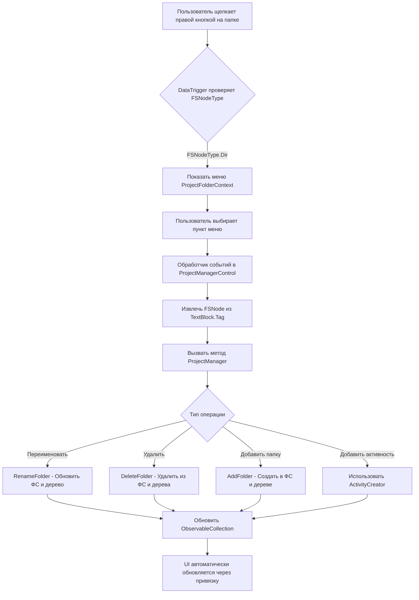

# План реализации контекстного меню для папок

## Обзор
Добавление функциональности контекстного меню для узлов-папок в TreeView элемента ProjectManagerControl, позволяющее пользователям выполнять операции с папками внутри структуры проекта.

## Анализ текущего состояния

### Существующие контекстные меню
1. **ProjectContext** (строки 16-30 в XAML)
   - Добавить скрипт
   - Добавить папку
   - Переименовать проект
   - Добавить зависимость

2. **ProjectFileContext** (строки 31-44 в XAML)
   - Открыть
   - Удалить файл
   - Переименовать
   - Открыть содержащую папку

### Перечисление FSNodeType
```csharp
public enum FSNodeType
{
    File,
    Dir,      // Это то, что нам нужно обработать
    Project
}
```

### Текущее назначение контекстных меню
- Строки 179-188 в XAML используют DataTriggers для назначения контекстных меню
- В настоящее время обрабатывается: `FSNodeType.File` и `FSNodeType.Project`
- Отсутствует: `FSNodeType.Dir`

## План реализации

### 1. Изменения в XAML (ProjectManagerControl.xaml)

#### Добавить ресурс контекстного меню для папок
Вставить после строки 44 (после ProjectFileContext):

```xml
<ContextMenu x:Key="ProjectFolderContext">
    <MenuItem Header="Переименовать"
              x:Name="RenameFolderMenuItem"
              Click="RenameFolderMenuItem_Click"/>
    <MenuItem Header="Удалить"
              x:Name="DeleteFolderMenuItem"
              Click="DeleteFolderMenuItem_Click"/>
    <Separator/>
    <MenuItem Header="Добавить папку"
              x:Name="AddFolderToFolderMenuItem"
              Click="AddFolderToFolderMenuItem_Click"/>
    <MenuItem Header="Добавить активность"
              x:Name="AddActivityToFolderMenuItem"
              Click="AddActivityToFolderMenuItem_Click"/>
</ContextMenu>
```

#### Добавить DataTrigger для узлов-папок
Вставить после строки 188 (после DataTrigger для Project):

```xml
<DataTrigger Binding="{Binding FSNodeType}"
             Value="{x:Static enums:FSNodeType.Dir}">
    <Setter Property="ContextMenu"
            Value="{StaticResource ProjectFolderContext}" />
</DataTrigger>
```

### 2. Изменения в коде (ProjectManagerControl.xaml.cs)

#### Добавить секцию обработчиков событий
Вставить после строки 161 (после #endregion Context menu project):

```csharp
#region Context menu folder

private void RenameFolderMenuItem_Click(object sender, RoutedEventArgs e)
{
    if (sender is MenuItem mnu)
    {
        TextBlock tb = ((ContextMenu)mnu.Parent).PlacementTarget as TextBlock;
        if (tb.Tag is FSNode fSNode)
        {
            // TODO: Показать диалог ввода для получения нового имени
            // Затем вызвать Services.ProjectManager.RenameFolder(fSNode, newName)
        }
    }
}

private void DeleteFolderMenuItem_Click(object sender, RoutedEventArgs e)
{
    if (sender is MenuItem mnu)
    {
        TextBlock tb = ((ContextMenu)mnu.Parent).PlacementTarget as TextBlock;
        if (tb.Tag is FSNode fSNode)
        {
            // Показать диалог подтверждения
            MessageBoxResult result = MessageBox.Show(
                $"Вы действительно хотите удалить папку '{fSNode.Name}' и всё её содержимое?",
                "Подтверждение удаления",
                MessageBoxButton.YesNo,
                MessageBoxImage.Warning);
            
            if (result == MessageBoxResult.Yes)
            {
                Services.ProjectManager.DeleteFolder(fSNode);
            }
        }
    }
}

private void AddFolderToFolderMenuItem_Click(object sender, RoutedEventArgs e)
{
    if (sender is MenuItem mnu)
    {
        TextBlock tb = ((ContextMenu)mnu.Parent).PlacementTarget as TextBlock;
        if (tb.Tag is FSNode fSNode)
        {
            // TODO: Показать диалог ввода для получения имени папки
            // Затем вызвать Services.ProjectManager.AddFolder(fSNode, folderName)
        }
    }
}

private void AddActivityToFolderMenuItem_Click(object sender, RoutedEventArgs e)
{
    if (sender is MenuItem mnu)
    {
        TextBlock tb = ((ContextMenu)mnu.Parent).PlacementTarget as TextBlock;
        if (tb.Tag is FSNode fSNode)
        {
            // TODO: Показать диалог создания активности или использовать существующий создатель
            // Аналогично AddActivity_Click, но с fSNode в качестве родителя
        }
    }
}

#endregion Context menu folder
```

### 3. Изменения в сервисе ProjectManager (Models/ProjectManager.cs)

#### Добавить методы для операций с папками

```csharp
/// <summary>
/// Переименовывает папку в дереве проекта
/// </summary>
internal CallResult RenameFolder(FSNode folderNode, string newName)
{
    if (folderNode.FSNodeType != FSNodeType.Dir)
    {
        return new CallResult { Error = new Error("Указанный узел не является папкой") };
    }

    try
    {
        string oldPath = folderNode.RuntimeFullPath;
        string parentPath = Path.GetDirectoryName(oldPath);
        string newPath = Path.Combine(parentPath, newName);

        if (Directory.Exists(newPath))
        {
            return new CallResult { Error = new Error($"Папка с именем '{newName}' уже существует") };
        }

        Directory.Move(oldPath, newPath);
        
        // Обновить FSNode
        folderNode.RuntimeFullPath = newPath;
        folderNode.Name = newName;
        
        // Рекурсивно обновить все дочерние узлы
        UpdateChildPaths(folderNode, oldPath, newPath);
        
        return new CallResult();
    }
    catch (Exception ex)
    {
        return new CallResult { Error = new Error($"Ошибка при переименовании папки: {ex.Message}") };
    }
}

/// <summary>
/// Удаляет папку и удаляет её из дерева
/// </summary>
internal CallResult DeleteFolder(FSNode folderNode)
{
    if (folderNode.FSNodeType != FSNodeType.Dir)
    {
        return new CallResult { Error = new Error("Указанный узел не является папкой") };
    }

    try
    {
        Directory.Delete(folderNode.RuntimeFullPath, true);
        
        // Удалить из дочерних элементов родителя
        FSNode parent = FindParentNode(FSNodes[0], folderNode);
        if (parent != null)
        {
            parent.Childs.Remove(folderNode);
        }
        
        return new CallResult();
    }
    catch (Exception ex)
    {
        return new CallResult { Error = new Error($"Ошибка при удалении папки: {ex.Message}") };
    }
}

/// <summary>
/// Создает новую папку внутри указанного узла папки
/// </summary>
internal CallResult AddFolder(FSNode parentNode, string folderName)
{
    if (parentNode.FSNodeType != FSNodeType.Dir && parentNode.FSNodeType != FSNodeType.Project)
    {
        return new CallResult { Error = new Error("Родительский узел должен быть папкой или проектом") };
    }

    try
    {
        string newFolderPath = Path.Combine(parentNode.RuntimeFullPath, folderName);
        
        if (Directory.Exists(newFolderPath))
        {
            return new CallResult { Error = new Error($"Папка '{folderName}' уже существует") };
        }

        Directory.CreateDirectory(newFolderPath);
        
        FSNode newNode = new FSNode(newFolderPath, FSNodeType.Dir)
        {
            Childs = new ObservableCollection<FSNode>()
        };
        
        parentNode.Childs.Add(newNode);
        
        return new CallResult();
    }
    catch (Exception ex)
    {
        return new CallResult { Error = new Error($"Ошибка при создании папки: {ex.Message}") };
    }
}

/// <summary>
/// Вспомогательный метод для обновления путей всех дочерних узлов после переименования
/// </summary>
private void UpdateChildPaths(FSNode node, string oldBasePath, string newBasePath)
{
    if (node.Childs == null) return;
    
    foreach (var child in node.Childs)
    {
        child.RuntimeFullPath = child.RuntimeFullPath.Replace(oldBasePath, newBasePath);
        UpdateChildPaths(child, oldBasePath, newBasePath);
    }
}

/// <summary>
/// Вспомогательный метод для поиска родительского узла
/// </summary>
private FSNode FindParentNode(FSNode current, FSNode target)
{
    if (current.Childs == null) return null;
    
    if (current.Childs.Contains(target))
    {
        return current;
    }
    
    foreach (var child in current.Childs)
    {
        var result = FindParentNode(child, target);
        if (result != null) return result;
    }
    
    return null;
}
```

## Соображения по пользовательскому интерфейсу

### Диалоги ввода
Для операций переименования и добавления папки потребуются диалоги ввода. Варианты:
1. Использовать простой `Microsoft.VisualBasic.Interaction.InputBox`
2. Создать пользовательские WPF диалоги
3. Использовать диалоги MahApps.Metro (так как проект уже использует MahApps)

### Создание активности
Для "Добавить активность в папку" можно:
1. Повторно использовать существующую логику создания активности
2. Передать путь узла папки в качестве родительского каталога
3. Использовать класс ActivityCreator (в Models/ActivityCreator.cs)

## Контрольный список тестирования

- [ ] Контекстное меню папки появляется при щелчке правой кнопкой мыши на узлах папок
- [ ] Переименование папки обновляет как файловую систему, так и представление дерева
- [ ] Удаление папки удаляет папку из файловой системы и представления дерева
- [ ] Добавление папки создает новый каталог и обновляет представление дерева
- [ ] Добавление активности в папку создает файл в правильном месте
- [ ] Все дочерние пути правильно обновляются после переименования папки
- [ ] Обработка ошибок работает для недопустимых операций
- [ ] Пользовательский интерфейс остается отзывчивым во время операций

## Диаграмма архитектуры



## Итоговая сводка

Этот план добавляет полную функциональность управления папками в дерево проекта:
- **Переименовать**: Обновляет имя папки в файловой системе и все дочерние пути
- **Удалить**: Рекурсивно удаляет папку из файловой системы и дерева
- **Добавить папку**: Создает новую подпапку
- **Добавить активность**: Создает новый файл активности в папке

Реализация следует существующим шаблонам в кодовой базе и бесшовно интегрируется с текущей системой контекстных меню.