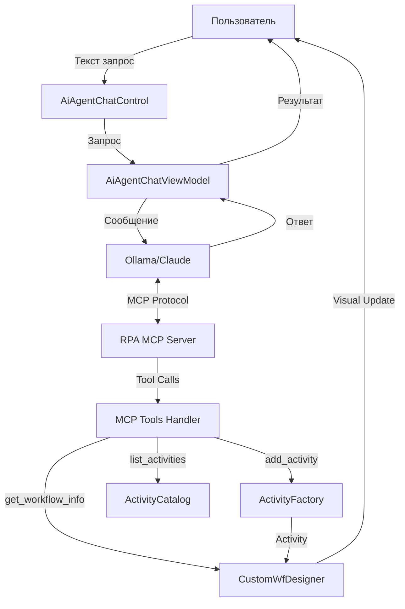

# MCP-сервер архитектура для RPA Studio

## Обзор

Model Context Protocol (MCP) - это открытый протокол для интеграции AI с внешними инструментами и данными. Использование MCP-сервера обеспечивает стандартизированный, безопасный и масштабируемый способ взаимодействия AI Agent с RPA Workflow Designer.

## Архитектура с MCP

### Общая схема



### Преимущества MCP подхода

1. **Стандартизация** - единый протокол для всех AI моделей
2. **Безопасность** - контроль доступа на уровне MCP сервера
3. **Расширяемость** - легко добавлять новые tools
4. **Тестируемость** - tools можно тестировать независимо
5. **Совместимость** - работает с любыми AI (Ollama, Claude, GPT)
6. **Документирование** - MCP автоматически генерирует описание tools

## Компоненты системы

### 1. RPA MCP Server

**Расположение:** `RPA/Mcp/RpaMcpServer.cs`

**Описание:** Основной MCP сервер, который:
- Запускается вместе с RPA Studio
- Регистрирует все доступные tools
- Обрабатывает входящие запросы от AI
- Возвращает результаты выполнения

**Протокол:** JSON-RPC 2.0 через stdio или HTTP

**Пример конфигурации:**
```json
{
  "mcpServers": {
    "rpa-studio": {
      "command": "RPA.exe",
      "args": ["--mcp-server"],
      "env": {
        "RPA_MCP_PORT": "3000"
      }
    }
  }
}
```

### 2. MCP Tools

#### Tool 1: add_activity

**Описание:** Добавляет новую активность в текущий workflow

**Схема:**
```json
{
  "name": "add_activity",
  "description": "Adds a new activity to the current workflow",
  "inputSchema": {
    "type": "object",
    "properties": {
      "activityType": {
        "type": "string",
        "description": "Type of activity (Sequence, If, While, WriteLine, etc.)",
        "enum": ["Sequence", "If", "While", "DoWhile", "ForEach", "WriteLine", "Assign", "Delay", "InvokeMethod", "TryCatch", "Flowchart"]
      },
      "displayName": {
        "type": "string",
        "description": "Display name for the activity"
      },
      "parameters": {
        "type": "object",
        "description": "Activity-specific parameters",
        "additionalProperties": true
      },
      "children": {
        "type": "array",
        "description": "Child activities for container activities",
        "items": {
          "$ref": "#"
        }
      }
    },
    "required": ["activityType"]
  }
}
```

**Пример вызова от AI:**
```json
{
  "jsonrpc": "2.0",
  "method": "tools/call",
  "params": {
    "name": "add_activity",
    "arguments": {
      "activityType": "Sequence",
      "displayName": "Главный процесс",
      "children": [
        {
          "activityType": "WriteLine",
          "parameters": {
            "text": "Hello, World!"
          }
        }
      ]
    }
  },
  "id": 1
}
```

**Ответ:**
```json
{
  "jsonrpc": "2.0",
  "result": {
    "success": true,
    "message": "Activity Sequence added to workflow",
    "activityId": "seq_001"
  },
  "id": 1
}
```

#### Tool 2: list_activities

**Описание:** Возвращает список всех доступных типов активностей с описаниями

**Схема:**
```json
{
  "name": "list_activities",
  "description": "Lists all available activity types with descriptions",
  "inputSchema": {
    "type": "object",
    "properties": {
      "category": {
        "type": "string",
        "description": "Filter by category (optional)",
        "enum": ["ControlFlow", "Primitives", "ErrorHandling", "Browser", "Flow", "Collection"]
      }
    }
  }
}
```

**Пример ответа:**
```json
{
  "jsonrpc": "2.0",
  "result": {
    "activities": [
      {
        "type": "Sequence",
        "displayName": "Sequence",
        "category": "ControlFlow",
        "description": "Executes activities in sequential order",
        "parameters": [
          {
            "name": "DisplayName",
            "type": "string",
            "required": false,
            "description": "Name shown in designer"
          }
        ]
      },
      {
        "type": "WriteLine",
        "displayName": "Write Line",
        "category": "Primitives",
        "description": "Writes text to console output",
        "parameters": [
          {
            "name": "Text",
            "type": "string",
            "required": true,
            "description": "Text to write"
          }
        ]
      }
    ]
  },
  "id": 2
}
```

#### Tool 3: get_workflow_info

**Описание:** Получает информацию о текущем workflow

**Схема:**
```json
{
  "name": "get_workflow_info",
  "description": "Gets information about the current workflow",
  "inputSchema": {
    "type": "object",
    "properties": {
      "includeActivities": {
        "type": "boolean",
        "description": "Include list of activities in workflow",
        "default": false
      }
    }
  }
}
```

**Пример ответа:**
```json
{
  "jsonrpc": "2.0",
  "result": {
    "filePath": "C:/Projects/MyProcess/Main.xaml",
    "isLoaded": true,
    "rootActivityType": "Sequence",
    "activityCount": 5,
    "activities": [
      {
        "type": "WriteLine",
        "displayName": "Write Line 1",
        "index": 0
      },
      {
        "type": "Delay",
        "displayName": "Wait 2 seconds",
        "index": 1
      }
    ]
  },
  "id": 3
}
```

#### Tool 4: remove_activity

**Описание:** Удаляет активность из workflow

**Схема:**
```json
{
  "name": "remove_activity",
  "description": "Removes an activity from the workflow",
  "inputSchema": {
    "type": "object",
    "properties": {
      "activityId": {
        "type": "string",
        "description": "ID of activity to remove"
      },
      "index": {
        "type": "integer",
        "description": "Index of activity to remove (alternative to activityId)"
      }
    },
    "oneOf": [
      {"required": ["activityId"]},
      {"required": ["index"]}
    ]
  }
}
```

#### Tool 5: update_activity

**Описание:** Обновляет параметры существующей активности

**Схема:**
```json
{
  "name": "update_activity",
  "description": "Updates parameters of an existing activity",
  "inputSchema": {
    "type": "object",
    "properties": {
      "activityId": {
        "type": "string",
        "description": "ID of activity to update"
      },
      "parameters": {
        "type": "object",
        "description": "New parameter values",
        "additionalProperties": true
      }
    },
    "required": ["activityId", "parameters"]
  }
}
```

#### Tool 6: save_workflow

**Описание:** Сохраняет текущий workflow

**Схема:**
```json
{
  "name": "save_workflow",
  "description": "Saves the current workflow to file",
  "inputSchema": {
    "type": "object",
    "properties": {
      "path": {
        "type": "string",
        "description": "File path (optional, uses current if not specified)"
      }
    }
  }
}
```

### 3. MCP Server Implementation

**Файл:** `RPA/Mcp/RpaMcpServer.cs`

```csharp
using System;
using System.Collections.Generic;
using System.Threading.Tasks;
using ModelContextProtocol;

namespace RPA.Mcp
{
    public class RpaMcpServer : IMcpServer
    {
        private readonly Dictionary<string, IMcpTool> _tools;
        private readonly CustomWfDesigner _designer;
        private readonly ActivityFactory _activityFactory;
        
        public RpaMcpServer()
        {
            _designer = CustomWfDesigner.GetInstance();
            _activityFactory = new ActivityFactory();
            
            // Регистрация tools
            _tools = new Dictionary<string, IMcpTool>
            {
                ["add_activity"] = new AddActivityTool(_designer, _activityFactory),
                ["list_activities"] = new ListActivitiesTool(_activityFactory),
                ["get_workflow_info"] = new GetWorkflowInfoTool(_designer),
                ["remove_activity"] = new RemoveActivityTool(_designer),
                ["update_activity"] = new UpdateActivityTool(_designer),
                ["save_workflow"] = new SaveWorkflowTool(_designer)
            };
        }
        
        public Task<McpServerInfo> Initialize()
        {
            return Task.FromResult(new McpServerInfo
            {
                Name = "rpa-studio",
                Version = "1.0.0",
                Description = "MCP Server for RPA Studio - provides tools for workflow automation"
            });
        }
        
        public Task<IEnumerable<McpTool>> ListTools()
        {
            var tools = new List<McpTool>();
            
            foreach (var tool in _tools.Values)
            {
                tools.Add(tool.GetSchema());
            }
            
            return Task.FromResult<IEnumerable<McpTool>>(tools);
        }
        
        public async Task<McpToolResult> CallTool(string name, object arguments)
        {
            if (!_tools.TryGetValue(name, out IMcpTool tool))
            {
                return new McpToolResult
                {
                    Success = false,
                    Error = $"Tool '{name}' not found"
                };
            }
            
            try
            {
                return await tool.Execute(arguments);
            }
            catch (Exception ex)
            {
                return new McpToolResult
                {
                    Success = false,
                    Error = ex.Message
                };
            }
        }
    }
}
```

### 4. Tool Implementation Example

**Файл:** `RPA/Mcp/Tools/AddActivityTool.cs`

```csharp
using System;
using System.Activities;
using System.Threading.Tasks;
using ModelContextProtocol;
using Newtonsoft.Json.Linq;

namespace RPA.Mcp.Tools
{
    public class AddActivityTool : IMcpTool
    {
        private readonly CustomWfDesigner _designer;
        private readonly ActivityFactory _activityFactory;
        
        public AddActivityTool(CustomWfDesigner designer, ActivityFactory activityFactory)
        {
            _designer = designer;
            _activityFactory = activityFactory;
        }
        
        public McpTool GetSchema()
        {
            return new McpTool
            {
                Name = "add_activity",
                Description = "Adds a new activity to the current workflow",
                InputSchema = new
                {
                    type = "object",
                    properties = new
                    {
                        activityType = new
                        {
                            type = "string",
                            description = "Type of activity",
                            @enum = new[] { "Sequence", "If", "While", "WriteLine", /* ... */ }
                        },
                        displayName = new
                        {
                            type = "string",
                            description = "Display name for the activity"
                        },
                        parameters = new
                        {
                            type = "object",
                            description = "Activity parameters"
                        },
                        children = new
                        {
                            type = "array",
                            description = "Child activities"
                        }
                    },
                    required = new[] { "activityType" }
                }
            };
        }
        
        public async Task<McpToolResult> Execute(object arguments)
        {
            var args = JObject.FromObject(arguments);
            
            // Валидация
            if (_designer.ActiveWorkflowDesignerEx == null)
            {
                return new McpToolResult
                {
                    Success = false,
                    Error = "No active workflow designer. Please open or create a workflow first."
                };
            }
            
            string activityType = args["activityType"]?.ToString();
            if (string.IsNullOrEmpty(activityType))
            {
                return new McpToolResult
                {
                    Success = false,
                    Error = "activityType is required"
                };
            }
            
            try
            {
                // Создание активности
                var command = new ActivityCommand
                {
                    ActivityType = activityType,
                    DisplayName = args["displayName"]?.ToString(),
                    Parameters = args["parameters"]?.ToObject<Dictionary<string, object>>(),
                    Children = args["children"]?.ToObject<List<ActivityCommand>>()
                };
                
                Activity activity = _activityFactory.CreateActivity(command);
                
                // Добавление в workflow
                var result = await AddActivityToWorkflow(activity);
                
                return new McpToolResult
                {
                    Success = result.Success,
                    Content = new
                    {
                        message = result.Message,
                        activityType = activityType,
                        displayName = activity.DisplayName
                    },
                    Error = result.Success ? null : result.Message
                };
            }
            catch (Exception ex)
            {
                return new McpToolResult
                {
                    Success = false,
                    Error = $"Failed to add activity: {ex.Message}"
                };
            }
        }
        
        private async Task<OperationResult> AddActivityToWorkflow(Activity activity)
        {
            // Реализация добавления активности (аналогично RpaAiIntegrationService)
            // ...
        }
    }
}
```

## Интеграция с AI

### Ollama с MCP

Ollama пока не имеет нативной поддержки MCP, но можно использовать промежуточный адаптер:

**Файл:** `RPA/Mcp/OllamaMcpAdapter.cs`

```csharp
public class OllamaMcpAdapter
{
    private readonly IOllamaService _ollamaService;
    private readonly RpaMcpServer _mcpServer;
    
    public async Task<string> ProcessWithTools(string userMessage, List<ChatMessage> history)
    {
        // 1. Добавляем системный промпт с описанием tools
        var tools = await _mcpServer.ListTools();
        string systemPrompt = GenerateSystemPrompt(tools);
        
        // 2. Отправляем запрос в Ollama
        var response = await _ollamaService.ChatAsync(userMessage, history, systemPrompt);
        
        // 3. Парсим ответ и извлекаем tool calls
        var toolCalls = ExtractToolCalls(response);
        
        // 4. Выполняем tool calls через MCP
        foreach (var call in toolCalls)
        {
            var result = await _mcpServer.CallTool(call.Name, call.Arguments);
            // Добавляем результат в контекст для следующего запроса
        }
        
        return response;
    }
}
```

### Claude/GPT с MCP

Claude Desktop и другие AI с нативной поддержкой MCP могут напрямую подключаться к серверу:

**Конфигурация Claude Desktop:**
```json
{
  "mcpServers": {
    "rpa-studio": {
      "command": "C:/Program Files/RPA Studio/RPA.exe",
      "args": ["--mcp-server", "--port", "3000"]
    }
  }
}
```

## Запуск MCP Server

### Вариант 1: В процессе приложения

```csharp
// В App.xaml.cs или EntryPoint.cs
public partial class App : Application
{
    private RpaMcpServer _mcpServer;
    private McpServerHost _mcpHost;
    
    protected override void OnStartup(StartupEventArgs e)
    {
        base.OnStartup(e);
        
        // Проверяем, запущено ли приложение в режиме MCP сервера
        if (e.Args.Contains("--mcp-server"))
        {
            StartMcpServer();
        }
        
        // Запускаем обычный UI
        // ...
    }
    
    private void StartMcpServer()
    {
        _mcpServer = new RpaMcpServer();
        
        // Запускаем сервер на stdio (для Claude Desktop)
        _mcpHost = new StdioMcpServerHost(_mcpServer);
        _mcpHost.Start();
        
        // Или на HTTP (для внешних приложений)
        // _mcpHost = new HttpMcpServerHost(_mcpServer, port: 3000);
    }
}
```

### Вариант 2: Отдельный процесс

Можно создать отдельный executable для MCP сервера:

**Файл:** `RPA.McpServer/Program.cs`

```csharp
class Program
{
    static async Task Main(string[] args)
    {
        var server = new RpaMcpServer();
        var host = new StdioMcpServerHost(server);
        
        await host.RunAsync();
    }
}
```

## Безопасность

### 1. Аутентификация
- API ключи для HTTP режима
- Process isolation для stdio режима

### 2. Авторизация
- Разрешения на уровне tool
- Валидация всех входных данных

### 3. Audit Log
```csharp
public class McpAuditLogger
{
    public void LogToolCall(string toolName, object arguments, McpToolResult result)
    {
        // Логирование всех вызовов tools
    }
}
```

## Тестирование MCP Server

### Unit тесты

```csharp
[TestClass]
public class AddActivityToolTests
{
    [TestMethod]
    public async Task AddActivity_Sequence_Success()
    {
        var tool = new AddActivityTool(_designer, _factory);
        
        var result = await tool.Execute(new
        {
            activityType = "Sequence",
            displayName = "Test Sequence"
        });
        
        Assert.IsTrue(result.Success);
        Assert.AreEqual("Activity Sequence added to workflow", result.Content.message);
    }
}
```

### Integration тесты с MCP протоколом

```csharp
[TestMethod]
public async Task McpProtocol_ToolCall_Success()
{
    var server = new RpaMcpServer();
    
    var request = new McpRequest
    {
        Method = "tools/call",
        Params = new
        {
            name = "add_activity",
            arguments = new
            {
                activityType = "WriteLine",
                parameters = new { text = "Test" }
            }
        }
    };
    
    var response = await server.HandleRequest(request);
    
    Assert.IsNotNull(response.Result);
    Assert.IsTrue(response.Result.Success);
}
```

## Преимущества MCP подхода

1. **Стандартизация**: Единый протокол для всех AI
2. **Безопасность**: Централизованный контроль доступа
3. **Масштабируемость**: Легко добавлять новые tools
4. **Совместимость**: Работает с любыми AI (Claude, GPT, Ollama)
5. **Документирование**: Самодокументирующиеся tools
6. **Тестируемость**: Каждый tool - независимый компонент
7. **Версионирование**: Поддержка разных версий API

## Timeline реализации с MCP

| Этап | Продолжительность | Описание |
|------|-------------------|----------|
| 1. MCP Server Core | 2-3 дня | Базовый сервер, JSON-RPC |
| 2. Базовые Tools | 3-4 дня | add_activity, list_activities, get_workflow_info |
| 3. Дополнительные Tools | 2-3 дня | remove_activity, update_activity, save_workflow |
| 4. Ollama Adapter | 1-2 дня | Адаптер для работы с Ollama |
| 5. Тестирование | 2-3 дня | Unit и integration тесты |
| **Итого** | **10-15 дней** | |

## Следующие шаги

1. Реализовать базовый MCP Server
2. Создать первые tools (add_activity, list_activities)
3. Интегрировать с Ollama через адаптер
4. Тестировать и отлаживать
5. Добавить остальные tools
6. Документировать API
