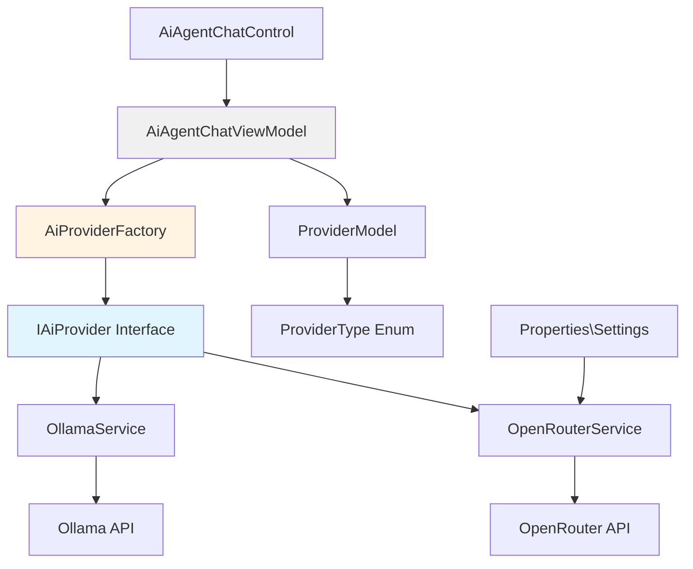
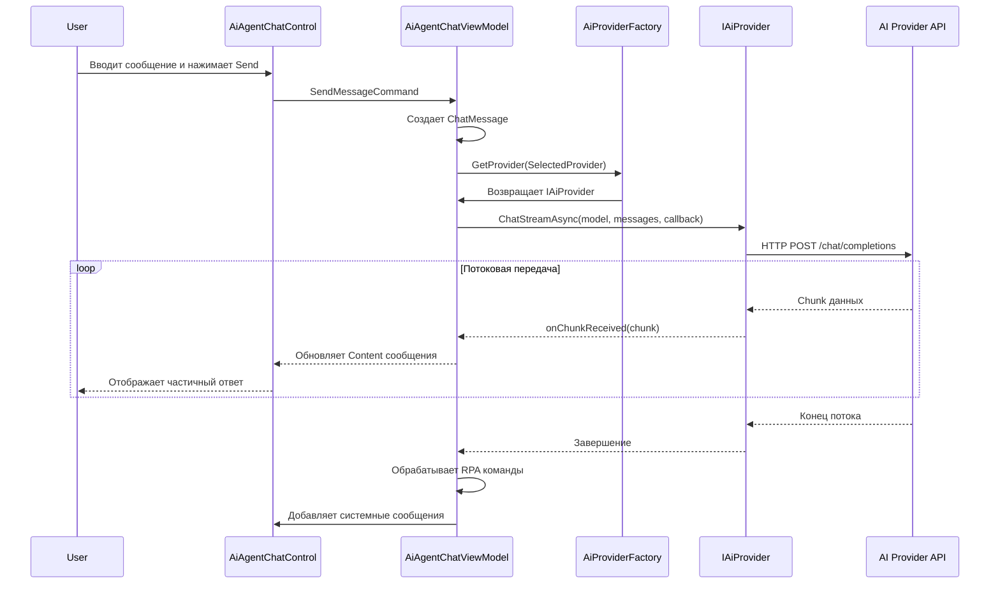
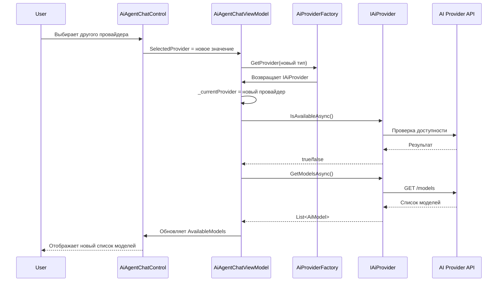

# OpenRouter Integration Architecture

## Обзор

Этот документ описывает архитектуру интеграции провайдера OpenRouter в систему AI Agent Chat Control, которая в настоящее время поддерживает только Ollama.

## Цели

1. Добавить поддержку OpenRouter в качестве альтернативного AI провайдера
2. Сохранить обратную совместимость с Ollama
3. Создать расширяемую архитектуру для добавления новых провайдеров в будущем
4. Обеспечить динамическое переключение между провайдерами
5. Поддержать динамическую загрузку моделей от OpenRouter

## Архитектурная Диаграмма



## Компоненты Архитектуры

### 1. Provider Abstraction Layer

#### 1.1 IAiProvider Interface
Базовый интерфейс для всех AI провайдеров.

**Файл:** `AiAgent/Services/IAiProvider.cs`

```csharp
public interface IAiProvider
{
    // Получение списка доступных моделей
    Task<List<AiModel>> GetModelsAsync();
    
    // Отправка сообщений с потоковой передачей
    Task ChatStreamAsync(
        string model,
        List<ChatMessage> messages,
        Action<string> onChunkReceived,
        CancellationToken cancellationToken = default);
    
    // Проверка доступности провайдера
    Task<bool> IsAvailableAsync();
    
    // Тип провайдера
    ProviderType Type { get; }
    
    // Название провайдера для отображения
    string DisplayName { get; }
}
```

#### 1.2 ProviderType Enum
Перечисление типов провайдеров.

**Файл:** `AiAgent/Models/ProviderType.cs`

```csharp
public enum ProviderType
{
    Ollama,
    OpenRouter
}
```

#### 1.3 AiModel Class
Унифицированная модель для представления AI моделей от разных провайдеров.

**Файл:** `AiAgent/Models/AiModel.cs`

```csharp
public class AiModel
{
    public string Id { get; set; }              // Уникальный ID модели
    public string Name { get; set; }            // Название модели
    public string DisplayName { get; set; }     // Отображаемое название
    public ProviderType Provider { get; set; }  // Провайдер модели
    public string Description { get; set; }     // Описание модели
    public DateTime? ModifiedAt { get; set; }   // Дата изменения (для Ollama)
    public long? Size { get; set; }             // Размер (для Ollama)
    public object Metadata { get; set; }        // Дополнительные метаданные
}
```

### 2. OpenRouter Service Implementation

#### 2.1 OpenRouterService
Реализация сервиса для работы с OpenRouter API.

**Файл:** `AiAgent/Services/OpenRouterService.cs`

**Основные возможности:**
- Аутентификация через API ключ
- Получение списка моделей от OpenRouter
- Потоковая передача ответов (SSE - Server-Sent Events)
- Обработка ошибок и rate limiting

**Ключевые методы:**
```csharp
public class OpenRouterService : IAiProvider, IDisposable
{
    private readonly HttpClient _httpClient;
    private readonly string _apiKey;
    private const string BaseUrl = "https://openrouter.ai/api/v1";
    
    public ProviderType Type => ProviderType.OpenRouter;
    public string DisplayName => "OpenRouter";
    
    public async Task<List<AiModel>> GetModelsAsync();
    public async Task ChatStreamAsync(...);
    public async Task<bool> IsAvailableAsync();
}
```

#### 2.2 OpenRouter API Models
Модели для работы с OpenRouter API.

**Файл:** `AiAgent/Models/OpenRouterModels.cs`

```csharp
// Запрос к OpenRouter Chat API
public class OpenRouterChatRequest
{
    [JsonProperty("model")]
    public string Model { get; set; }
    
    [JsonProperty("messages")]
    public OpenRouterMessage[] Messages { get; set; }
    
    [JsonProperty("stream")]
    public bool Stream { get; set; }
}

// Ответ от OpenRouter
public class OpenRouterChatResponse
{
    [JsonProperty("id")]
    public string Id { get; set; }
    
    [JsonProperty("choices")]
    public OpenRouterChoice[] Choices { get; set; }
}

// Модель из списка моделей OpenRouter
public class OpenRouterModelInfo
{
    [JsonProperty("id")]
    public string Id { get; set; }
    
    [JsonProperty("name")]
    public string Name { get; set; }
    
    [JsonProperty("description")]
    public string Description { get; set; }
}
```

### 3. Provider Factory

#### 3.1 AiProviderFactory
Фабрика для создания экземпляров провайдеров.

**Файл:** `AiAgent/Services/AiProviderFactory.cs`

```csharp
public class AiProviderFactory
{
    private readonly Dictionary<ProviderType, IAiProvider> _providers;
    
    public AiProviderFactory()
    {
        _providers = new Dictionary<ProviderType, IAiProvider>
        {
            { ProviderType.Ollama, new OllamaService() },
            { ProviderType.OpenRouter, new OpenRouterService() }
        };
    }
    
    public IAiProvider GetProvider(ProviderType type)
    {
        return _providers.ContainsKey(type) 
            ? _providers[type] 
            : throw new ArgumentException($"Provider {type} not found");
    }
    
    public List<ProviderType> GetAvailableProviders()
    {
        return _providers.Keys.ToList();
    }
}
```

### 4. Configuration Updates

#### 4.1 Properties\Settings.settings Changes
Добавление настроек для OpenRouter API ключа.

**Файл:** `Properties\Settings.settings`

```xml
<Settings>
    <!-- Existing settings -->
    <Setting Name="OpenRouterApiKey" Type="System.String" Scope="User">
        <Value Profile="(Default)" />
    </Setting>
    <Setting Name="SelectedAiProvider" Type="System.String" Scope="User">
        <Value Profile="(Default)">Ollama</Value>
    </Setting>
</Settings>
```

**Доступ к настройкам в коде:**
```csharp
// Чтение API ключа
string apiKey = RPA.Properties.Settings.Default.OpenRouterApiKey;

// Сохранение API ключа
RPA.Properties.Settings.Default.OpenRouterApiKey = "your-api-key";
RPA.Properties.Settings.Default.Save();

// Чтение выбранного провайдера
string provider = RPA.Properties.Settings.Default.SelectedAiProvider;

// Сохранение выбранного провайдера
RPA.Properties.Settings.Default.SelectedAiProvider = "OpenRouter";
RPA.Properties.Settings.Default.Save();
```

### 5. ViewModel Updates

#### 5.1 AiAgentChatViewModel Changes
Обновление ViewModel для поддержки множественных провайдеров.

**Изменения:**
1. Замена [`IOllamaService`](AiAgent/Services/IOllamaService.cs:12) на [`IAiProvider`]
2. Добавление свойства `SelectedProvider`
3. Добавление коллекции `AvailableProviders`
4. Обновление логики загрузки моделей
5. Добавление команды `SwitchProviderCommand`

```csharp
public class AiAgentChatViewModel : INotifyPropertyChanged
{
    private readonly AiProviderFactory _providerFactory;
    private IAiProvider _currentProvider;
    private ProviderType _selectedProvider;
    
    public ObservableCollection<ProviderType> AvailableProviders { get; }
    
    public ProviderType SelectedProvider
    {
        get => _selectedProvider;
        set
        {
            if (_selectedProvider != value)
            {
                _selectedProvider = value;
                _currentProvider = _providerFactory.GetProvider(value);
                OnPropertyChanged(nameof(SelectedProvider));
                _ = LoadModelsAsync();
            }
        }
    }
    
    // Обновленный конструктор
    public AiAgentChatViewModel(
        AiProviderFactory providerFactory,
        IConversationStorage conversationStorage,
        IRpaAiIntegrationService rpaIntegration)
    {
        _providerFactory = providerFactory;
        // ... остальная инициализация
    }
}
```

### 6. UI Updates

#### 6.1 AiAgentChatControl.xaml Changes
Добавление выбора провайдера в UI.

**Изменения:**
- Добавление ComboBox для выбора провайдера
- Обновление отображения моделей с учетом провайдера

```xml
<StackPanel Grid.Column="0" Orientation="Horizontal">
    <TextBlock Text="Провайдер:"
               VerticalAlignment="Center"
               Margin="0,0,8,0"
               FontWeight="SemiBold"/>
    <ComboBox Width="150"
              ItemsSource="{Binding AvailableProviders}"
              SelectedItem="{Binding SelectedProvider}"
              VerticalAlignment="Center"
              Margin="0,0,8,0"/>
    
    <TextBlock Text="Модель:"
               VerticalAlignment="Center"
               Margin="0,0,8,0"
               FontWeight="SemiBold"/>
    <ComboBox Width="250"
              ItemsSource="{Binding AvailableModels}"
              SelectedItem="{Binding SelectedModel}"
              DisplayMemberPath="DisplayName"
              VerticalAlignment="Center"/>
</StackPanel>
```

#### 6.2 AiAgentChatControl.xaml.cs Changes
Обновление инициализации контрола.

```csharp
public AiAgentChatControl()
{
    InitializeComponent();

    // Создаем фабрику провайдеров
    AiProviderFactory providerFactory = new AiProviderFactory();
    JsonConversationStorage conversationStorage = new JsonConversationStorage();

    // Создаем MCP инфраструктуру
    RpaMcpServer mcpServer = new RpaMcpServer();
    ActivityCommandParser commandParser = new ActivityCommandParser();
    RpaAiIntegrationService rpaIntegration = new RpaAiIntegrationService(commandParser, mcpServer);

    // Создаем ViewModel
    AiAgentChatViewModel viewModel = new AiAgentChatViewModel(
        providerFactory,
        conversationStorage,
        rpaIntegration
    )
    {
        SystemPrompt = ActivityPrompts.GetSystemPrompt()
    };

    DataContext = viewModel;
    
    // ... остальная инициализация
}
```

## Поток Данных

### Диаграмма Последовательности: Отправка Сообщения



### Диаграмма Последовательности: Переключение Провайдера



## Обработка Ошибок

### Стратегии Обработки Ошибок

1. **Отсутствие API ключа (OpenRouter)**
   - Показать предупреждение пользователю
   - Предложить ввести API ключ в настройках
   - Отключить функциональность OpenRouter

2. **Недоступность провайдера**
   - Показать статусное сообщение
   - Предложить переключиться на другого провайдера
   - Сохранить последнего работающего провайдера

3. **Ошибки API**
   - Логирование всех ошибок API
   - Отображение понятных сообщений пользователю
   - Повторные попытки для временных ошибок

4. **Rate Limiting**
   - Обнаружение ошибок rate limit
   - Информирование пользователя о лимитах
   - Автоматическая задержка перед повторными запросами

## Миграция и Совместимость

### Обратная Совместимость

1. **Существующий код Ollama**
   - [`OllamaService`](AiAgent/Services/OllamaService.cs:17) будет реализовывать [`IAiProvider`]
   - Минимальные изменения в существующей логике
   - Ollama остается провайдером по умолчанию

2. **Сохраненные диалоги**
   - Добавить поле `Provider` в [`Conversation`] модель
   - Миграция существующих диалогов (установить Provider = Ollama)
   - Загрузка моделей при открытии старых диалогов

3. **Настройки**
   - Новые настройки в Properties\Settings.settings
   - Значения по умолчанию для новых пользователей
   - Миграция настроек для существующих пользователей

## Тестирование

### План Тестирования

1. **Unit Tests**
   - Тесты для [`OpenRouterService`]
   - Тесты для [`AiProviderFactory`]
   - Моки для HTTP запросов

2. **Integration Tests**
   - Тестирование переключения провайдеров
   - Тестирование загрузки моделей
   - Тестирование потоковой передачи

3. **UI Tests**
   - Тестирование выбора провайдера
   - Тестирование выбора моделей
   - Тестирование отправки сообщений

4. **Manual Tests**
   - Проверка работы с реальным Ollama
   - Проверка работы с реальным OpenRouter API
   - Проверка переключения между провайдерами
   - Проверка обработки ошибок

## Безопасность

### Меры Безопасности

1. **API Key Management**
   - Хранение в Properties\Settings.settings (автоматически шифруется .NET)
   - Не логировать API ключи
   - Валидация формата API ключа

2. **HTTPS Only**
   - Все запросы к OpenRouter через HTTPS
   - Проверка SSL сертификатов

3. **Data Privacy**
   - Не передавать чувствительные данные в промптах
   - Логировать только метаданные, не содержимое
   - Опция для локальной обработки (Ollama)

## Производительность

### Оптимизации

1. **Кэширование Моделей**
   - Кэширование списка моделей на 5 минут
   - Ленивая загрузка моделей

2. **Потоковая Передача**
   - Батчинг обновлений UI (50ms интервал)
   - Асинхронная обработка чанков

3. **HTTP Client Pooling**
   - Переиспользование HttpClient
   - Connection pooling

## Расширяемость

### Добавление Новых Провайдеров

Для добавления нового провайдера (например, Anthropic Claude):

1. Создать класс `ClaudeService : IAiProvider`
2. Реализовать все методы интерфейса
3. Добавить `ProviderType.Claude` в enum
4. Зарегистрировать в [`AiProviderFactory`]
5. Добавить настройки в Properties\Settings.settings (если нужны)

```csharp
public class ClaudeService : IAiProvider
{
    public ProviderType Type => ProviderType.Claude;
    public string DisplayName => "Anthropic Claude";
    
    // Реализация методов интерфейса
}
```

## Документация Пользователя

### Руководство по Настройке OpenRouter

1. Получить API ключ на https://openrouter.ai/
2. Открыть настройки приложения
3. Ввести API ключ в поле "OpenRouter API Key"
4. Выбрать "OpenRouter" в выпадающем списке провайдеров
5. Выбрать нужную модель из списка
6. Начать использование

### Сравнение Провайдеров

| Характеристика | Ollama | OpenRouter |
|----------------|--------|------------|
| Расположение | Локальный | Облачный |
| Требуется API ключ | Нет | Да |
| Интернет соединение | Нет | Да |
| Стоимость | Бесплатно | По тарифу |
| Доступные модели | Установленные локально | 100+ моделей |
| Скорость | Зависит от железа | Быстрая |
| Приватность | Полная | Зависит от политики |

## Заключение

Данная архитектура обеспечивает:

✅ Расширяемость для новых провайдеров
✅ Обратную совместимость с Ollama  
✅ Чистое разделение ответственности
✅ Простоту тестирования
✅ Удобство использования для пользователя
✅ Безопасное хранение API ключей
✅ Оптимальную производительность

Следующие шаги - переход в режим Code для реализации описанной архитектуры.