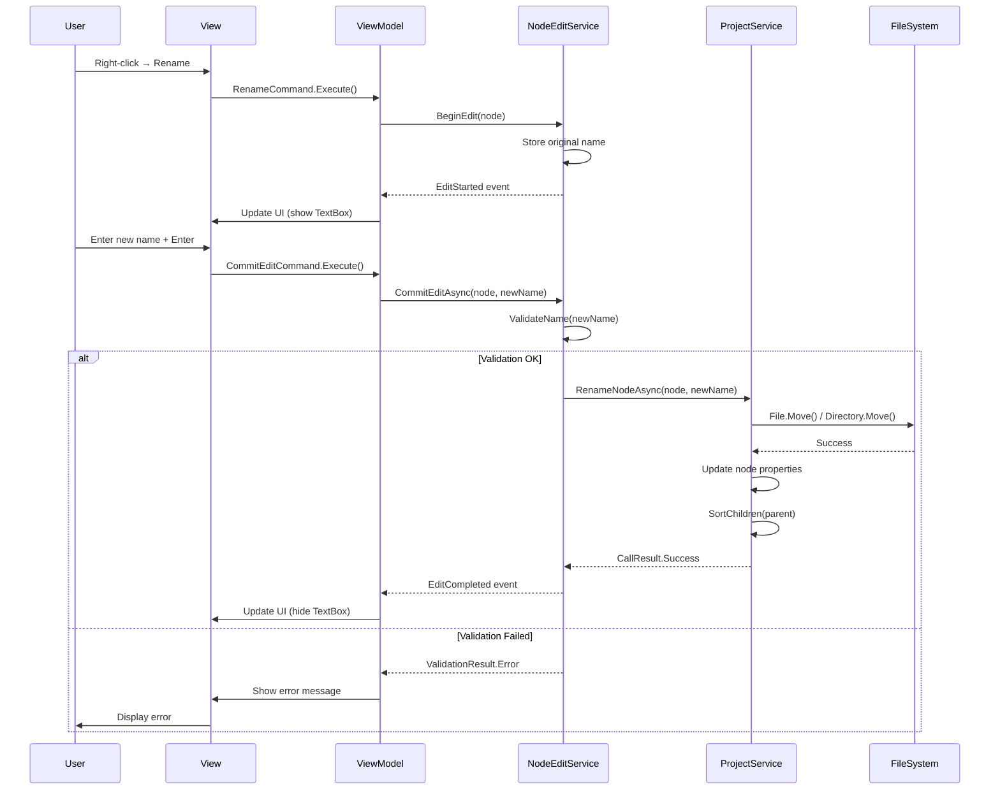
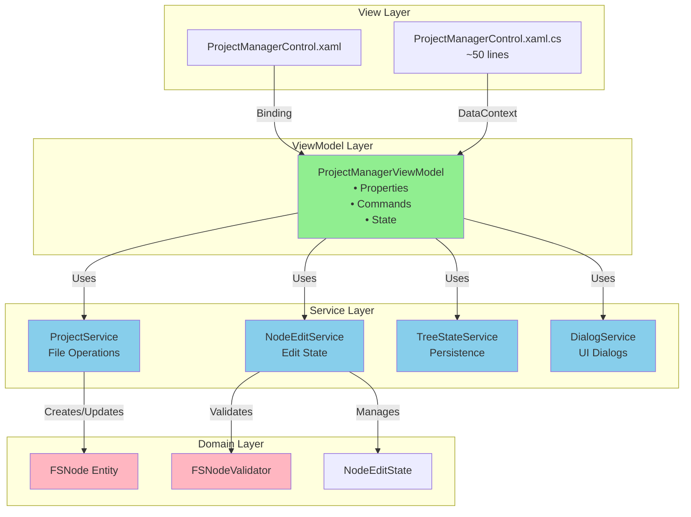
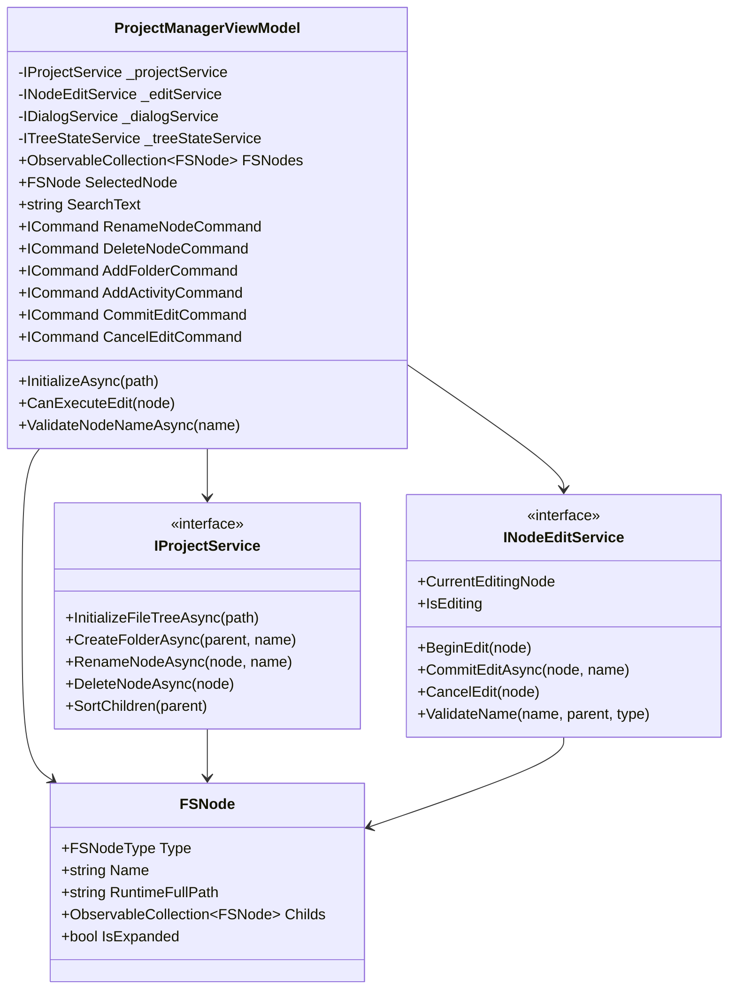

# План рефакторинга ProjectManagerControl

## 📋 Оглавление

1. [Анализ текущих проблем](#анализ-текущих-проблем)
2. [Предлагаемая архитектура](#предлагаемая-архитектура)
3. [Компоненты новой архитектуры](#компоненты-новой-архитектуры)
4. [Диаграммы](#диаграммы)
5. [План миграции](#план-миграции)
6. [Преимущества нового подхода](#преимущества-нового-подхода)

---

## 🔍 Анализ текущих проблем

### Проблема 1: Нарушение MVVM паттерна
**Текущее состояние:**
- 1085 строк кода в code-behind
- Вся бизнес-логика смешана с UI-логикой
- Невозможность тестирования без UI

**Пример проблемного кода:**
```csharp
// Строки 423-586: Бизнес-логика в code-behind
private async void CommitRename(FSNode fSNode, string newName)
{
    // 163 строки сложной логики создания/переименования
    // Прямое обращение к Services.ProjectManager
    // Прямая работа с диалогами
}
```

### Проблема 2: God Object Anti-Pattern
**Контрол делает слишком много:**
- ✅ Управление UI (TreeView, TextBox)
- ✅ Бизнес-логика (создание, переименование, удаление)
- ✅ Валидация данных
- ✅ Управление состоянием редактирования
- ✅ Работа с файловой системой
- ✅ Сохранение настроек (состояние дерева)
- ✅ Обработка Drag & Drop
- ✅ Сортировка узлов

### Проблема 3: Дублирование кода
**Две реализации одной логики:**

| Функция | ProjectManagerControl | Models/ProjectManager |
|---------|----------------------|----------------------|
| RenameFile | Строки 553-557 | Строки 170-200 |
| RenameFolder | Строки 548-552 | Строки 253-286 |
| RenameProject | Строки 558-562 | Строки 205-248 |
| DeleteFolder | Строки 623-653 | Строки 291-315 |
| SortChildren | Строки 1058-1078 | Строки 403-423 |
| FindParent | Строки 591-621 | Строки 376-398 |

### Проблема 4: Сложная логика редактирования
**Множество взаимосвязанных флагов и состояний:**
```csharp
private bool _justCommittedFromRightClick = false;  // Строка 30
FSNode.IsEditing   // В сущности
FSNode.IsNew       // В сущности
FSNode.IsExpanded  // В сущности
FSNode.OriginalName // В сущности
```

**Запутанная цепочка событий:**
1. `Grid_PreviewMouseRightButtonDown` → проверка источника клика
2. `EditTextBox_PreviewMouseRightButtonDown` → установка флага
3. `Grid_ContextMenuOpening` → проверка флага
4. `ContextMenu_Opened` → коммит редактирования
5. `EditTextBox_LostFocus` → коммит редактирования
6. `CommitRename` → 163 строки логики

### Проблема 5: Отсутствие разделения ответственностей

**Текущая структура:**
```
ProjectManagerControl.xaml.cs (1085 строк)
├── UI Event Handlers (20+ методов)
├── Business Logic (создание, удаление, переименование)
├── State Management (редактирование, expand/collapse)
├── Validation Logic
├── File System Operations
└── Settings Persistence
```

### Проблема 6: Tight Coupling
**Прямые зависимости:**
- `Services.ProjectManager` - статический доступ
- `Window.GetWindow(this)` - зависимость от Window
- `CustomWfDesigner.GetInstance()` - singleton
- `Properties.Settings.Default` - глобальное состояние

### Проблема 7: Отсутствие тестируемости
**Невозможно протестировать:**
- Логику создания узлов
- Валидацию имён
- Обработку ошибок
- Состояние редактирования
- Сортировку узлов

---

## 🏗️ Предлагаемая архитектура

### Архитектурный подход: MVVM + Services + Command Pattern

```
┌─────────────────────────────────────────────────────────────┐
│                         View Layer                          │
│  ┌─────────────────────────────────────────────────────┐   │
│  │    ProjectManagerControl.xaml/.xaml.cs              │   │
│  │    • Минимальный code-behind (<50 строк)            │   │
│  │    • Только UI-специфичная логика                   │   │
│  │    • Binding к ViewModel                            │   │
│  └─────────────────────────────────────────────────────┘   │
└─────────────────────────────────────────────────────────────┘
                            ↕ Binding
┌─────────────────────────────────────────────────────────────┐
│                      ViewModel Layer                        │
│  ┌─────────────────────────────────────────────────────┐   │
│  │    ProjectManagerViewModel                          │   │
│  │    • ObservableCollection<FSNode> FSNodes           │   │
│  │    • ICommand RenameCommand                         │   │
│  │    • ICommand DeleteCommand                         │   │
│  │    • ICommand AddFolderCommand                      │   │
│  │    • ICommand AddActivityCommand                    │   │
│  │    • Управление состоянием редактирования           │   │
│  └─────────────────────────────────────────────────────┘   │
└─────────────────────────────────────────────────────────────┘
                            ↕ Uses
┌─────────────────────────────────────────────────────────────┐
│                       Service Layer                         │
│  ┌──────────────────┐  ┌──────────────────┐  ┌──────────┐  │
│  │ IProjectService  │  │ INodeEditService │  │ IDialog  │  │
│  │ • GetFileTree()  │  │ • BeginEdit()    │  │ Service  │  │
│  │ • CreateFolder() │  │ • CommitEdit()   │  └──────────┘  │
│  │ • RenameNode()   │  │ • CancelEdit()   │                │
│  │ • DeleteNode()   │  │ • ValidateName() │                │
│  └──────────────────┘  └──────────────────┘                │
└─────────────────────────────────────────────────────────────┘
                            ↕ Uses
┌─────────────────────────────────────────────────────────────┐
│                        Domain Layer                         │
│  ┌─────────────┐  ┌──────────────┐  ┌──────────────────┐   │
│  │   FSNode    │  │  Project     │  │  FSNodeValidator │   │
│  │   (Entity)  │  │  (Entity)    │  │  (Domain Logic)  │   │
│  └─────────────┘  └──────────────┘  └──────────────────┘   │
└─────────────────────────────────────────────────────────────┘
```

---

## 🧩 Компоненты новой архитектуры

### 1. ProjectManagerViewModel

**Ответственность:**
- Управление коллекцией FSNodes
- Координация команд пользователя
- Управление состоянием UI (expand/collapse)
- Валидация пользовательского ввода

**Основные свойства:**
```csharp
public class ProjectManagerViewModel : BaseViewModel
{
    private readonly IProjectService _projectService;
    private readonly INodeEditService _nodeEditService;
    private readonly IDialogService _dialogService;
    private readonly ITreeStateService _treeStateService;
    
    // Основные свойства
    public ObservableCollection<FSNode> FSNodes { get; set; }
    public FSNode SelectedNode { get; set; }
    public FSNode EditingNode { get; set; }
    public string SearchText { get; set; }
    
    // Commands
    public ICommand RenameNodeCommand { get; }
    public ICommand DeleteNodeCommand { get; }
    public ICommand AddFolderCommand { get; }
    public ICommand AddActivityCommand { get; }
    public ICommand BeginEditCommand { get; }
    public ICommand CommitEditCommand { get; }
    public ICommand CancelEditCommand { get; }
    public ICommand ExpandAllCommand { get; }
    public ICommand CollapseAllCommand { get; }
    public ICommand OpenProjectFolderCommand { get; }
    
    // Методы
    public async Task InitializeAsync(string projectPath);
    public bool CanExecuteEdit(FSNode node);
    public Task<bool> ValidateNodeNameAsync(string name, FSNode parent);
}
```

### 2. IProjectService

**Ответственность:**
- Операции с файловой системой
- Инициализация дерева проекта
- CRUD операции над узлами

```csharp
public interface IProjectService
{
    // Инициализация
    Task<CallResult<ObservableCollection<FSNode>>> InitializeFileTreeAsync(string dirPath);
    
    // Операции с узлами
    Task<CallResult> CreateFolderAsync(FSNode parent, string folderName);
    Task<CallResult> CreateActivityAsync(FSNode parent, string activityName);
    Task<CallResult> RenameNodeAsync(FSNode node, string newName);
    Task<CallResult> DeleteNodeAsync(FSNode node);
    
    // Утилиты
    Task<bool> NodeExistsAsync(FSNode parent, string name, FSNodeType type);
    string GenerateUniqueName(FSNode parent, string baseName, FSNodeType type);
    void SortChildren(FSNode parent);
}
```

### 3. INodeEditService

**Ответственность:**
- Управление состоянием редактирования
- Отслеживание активного редактирования
- Валидация имён узлов

```csharp
public interface INodeEditService
{
    // Управление редактированием
    void BeginEdit(FSNode node);
    Task<CallResult> CommitEditAsync(FSNode node, string newName);
    void CancelEdit(FSNode node);
    
    // Состояние
    FSNode CurrentEditingNode { get; }
    bool IsEditing { get; }
    
    // Валидация
    ValidationResult ValidateName(string name, FSNode parent, FSNodeType type);
    bool IsNameAvailable(string name, FSNode parent, FSNodeType type);
    
    // События
    event EventHandler<NodeEditEventArgs> EditStarted;
    event EventHandler<NodeEditEventArgs> EditCompleted;
    event EventHandler<NodeEditEventArgs> EditCancelled;
}
```

### 4. ITreeStateService

**Ответственность:**
- Сохранение/восстановление состояния дерева
- Управление expand/collapse узлов

```csharp
public interface ITreeStateService
{
    // Сохранение состояния
    void SaveTreeState(ObservableCollection<FSNode> nodes);
    void RestoreTreeState(ObservableCollection<FSNode> nodes);
    
    // Операции
    void ExpandAll(ObservableCollection<FSNode> nodes);
    void CollapseAll(ObservableCollection<FSNode> nodes);
    void ExpandNode(FSNode node, bool recursive = false);
    void CollapseNode(FSNode node, bool recursive = false);
}
```

### 5. IDialogService

**Ответственность:**
- Абстракция для диалоговых окон
- Тестируемость (mock в тестах)

```csharp
public interface IDialogService
{
    Task<bool> ShowConfirmationAsync(string title, string message);
    Task ShowErrorAsync(string title, string message);
    Task ShowInfoAsync(string title, string message);
    Task<MessageDialogResult> ShowMessageAsync(
        string title, 
        string message, 
        MessageDialogStyle style = MessageDialogStyle.Affirmative);
}
```

### 6. FSNodeValidator (Domain Logic)

**Ответственность:**
- Бизнес-правила валидации имён
- Независимая, тестируемая логика

```csharp
public class FSNodeValidator
{
    private static readonly char[] InvalidFileNameChars = 
        Path.GetInvalidFileNameChars();
    
    public ValidationResult ValidateName(string name, FSNodeType type)
    {
        if (string.IsNullOrWhiteSpace(name))
            return ValidationResult.Error("Имя не может быть пустым");
            
        if (name.IndexOfAny(InvalidFileNameChars) >= 0)
            return ValidationResult.Error("Имя содержит недопустимые символы");
            
        if (type == FSNodeType.File && !name.EndsWith(".xaml"))
            name += ".xaml";
            
        return ValidationResult.Success(name);
    }
    
    public bool IsNameAvailable(string name, FSNode parent, FSNodeType type)
    {
        if (parent?.Childs == null) return true;
        
        return !parent.Childs.Any(n => 
            n.FSNodeType == type && 
            string.Equals(n.Name, name, StringComparison.OrdinalIgnoreCase));
    }
}
```

### 7. Обновлённая FSNode Entity

**Убираем UI-логику из сущности:**

```csharp
public class FSNode : INotifyPropertyChanged
{
    // Основные свойства (без изменений)
    public FSNodeType FSNodeType { get; set; }
    public string Name { get; set; }
    public string RuntimeFullPath { get; set; }
    public ObservableCollection<FSNode> Childs { get; set; }
    
    // UI State (переносим в ViewModel или используем attached properties)
    public bool IsExpanded { get; set; }
    
    // УДАЛЯЕМ эти свойства - переносим в EditingState
    // public bool IsEditing { get; set; }      ❌
    // public bool IsNew { get; set; }          ❌
    // public string OriginalName { get; set; } ❌
}
```

### 8. NodeEditState (новый класс)

**Инкапсулирует состояние редактирования:**

```csharp
public class NodeEditState
{
    public FSNode Node { get; set; }
    public string OriginalName { get; set; }
    public bool IsNewNode { get; set; }
    public DateTime EditStartTime { get; set; }
    
    public bool HasChanges => 
        Node?.Name != OriginalName;
}
```

---

## 📊 Диаграммы

### Диаграмма последовательности: Переименование узла



### Диаграмма компонентов: Новая архитектура



### Диаграмма классов: ProjectManagerViewModel



---

## 🚀 План миграции

### Этап 1: Подготовка (1-2 дня)

**1.1 Создание сервисных интерфейсов**
- [ ] `IProjectService.cs`
- [ ] `INodeEditService.cs`
- [ ] `ITreeStateService.cs`
- [ ] `IDialogService.cs`

**1.2 Создание доменных классов**
- [ ] `FSNodeValidator.cs`
- [ ] `NodeEditState.cs`
- [ ] `ValidationResult.cs`

### Этап 2: Реализация сервисов (3-4 дня)

**2.1 ProjectService**
```csharp
// Services/ProjectService.cs
public class ProjectService : IProjectService
{
    // Перенести логику из Models/ProjectManager
    // + логику из ProjectManagerControl (создание узлов)
}
```

**2.2 NodeEditService**
```csharp
// Services/NodeEditService.cs
public class NodeEditService : INodeEditService
{
    private NodeEditState _currentEdit;
    private readonly FSNodeValidator _validator;
    
    // Вся логика редактирования здесь
}
```

**2.3 TreeStateService**
```csharp
// Services/TreeStateService.cs
public class TreeStateService : ITreeStateService
{
    // Перенести логику из ProjectManagerControl
    // (SaveTreeState, RestoreTreeState, Expand/Collapse)
}
```

**2.4 DialogService**
```csharp
// Services/DialogService.cs
public class DialogService : IDialogService
{
    // Обёртка над MahApps.Metro.Controls.Dialogs
}
```

### Этап 3: Создание ViewModel (2-3 дня)

**3.1 ProjectManagerViewModel**
```csharp
// ViewModels/ProjectManagerViewModel.cs
public class ProjectManagerViewModel : BaseViewModel
{
    // Dependency Injection
    public ProjectManagerViewModel(
        IProjectService projectService,
        INodeEditService editService,
        IDialogService dialogService,
        ITreeStateService treeStateService)
    {
        _projectService = projectService;
        _editService = editService;
        _dialogService = dialogService;
        _treeStateService = treeStateService;
        
        InitializeCommands();
    }
    
    private void InitializeCommands()
    {
        RenameNodeCommand = new RelayCommand<FSNode>(
            node => BeginRename(node),
            node => CanRename(node));
            
        DeleteNodeCommand = new AsyncRelayCommand<FSNode>(
            node => DeleteNodeAsync(node),
            node => CanDelete(node));
            
        // ... остальные команды
    }
}
```

**3.2 Commands Implementation**
```csharp
private async Task DeleteNodeAsync(FSNode node)
{
    bool confirmed = await _dialogService.ShowConfirmationAsync(
        "Подтверждение удаления",
        $"Удалить '{node.Name}'?");
    
    if (!confirmed) return;
    
    var result = await _projectService.DeleteNodeAsync(node);
    
    if (result.Error != null)
    {
        await _dialogService.ShowErrorAsync("Ошибка", result.Error.Message);
    }
}
```

### Этап 4: Рефакторинг View (1-2 дня)

**4.1 Обновление XAML**
```xml
<!-- ProjectManagerControl.xaml -->
<UserControl x:Class="RPA.Controls.ProjectManagerControl"
             DataContext="{Binding Source={StaticResource Locator}, 
                          Path=ProjectManager}">
    
    <!-- Bindings к ViewModel -->
    <TreeView ItemsSource="{Binding FSNodes}"
              SelectedItem="{Binding SelectedNode}">
        
        <!-- Context Menu с Commands -->
        <ContextMenu>
            <MenuItem Header="Переименовать"
                      Command="{Binding RenameNodeCommand}"
                      CommandParameter="{Binding SelectedNode}"/>
            <MenuItem Header="Удалить"
                      Command="{Binding DeleteNodeCommand}"
                      CommandParameter="{Binding SelectedNode}"/>
        </ContextMenu>
    </TreeView>
</UserControl>
```

**4.2 Минимальный code-behind**
```csharp
// ProjectManagerControl.xaml.cs (~30 строк)
public partial class ProjectManagerControl : UserControl
{
    public ProjectManagerControl()
    {
        InitializeComponent();
    }
    
    // Только UI-специфичная логика (Drag&Drop, Focus)
    private void TextBlock_MouseDown(object sender, MouseButtonEventArgs e)
    {
        if (e.ChangedButton != MouseButton.Left) return;
        
        // Drag&Drop logic
        var textBlock = (TextBlock)sender;
        var node = (FSNode)textBlock.Tag;
        
        var vm = DataContext as ProjectManagerViewModel;
        vm?.BeginDragDrop(node);
    }
}
```

### Этап 5: Обновление FSNode (1 день)

**5.1 Убрать UI-состояние из Entity**
```csharp
public class FSNode : INotifyPropertyChanged
{
    // Оставляем только domain properties
    public FSNodeType FSNodeType { get; set; }
    public string Name { get; set; }
    public string RuntimeFullPath { get; set; }
    public ObservableCollection<FSNode> Childs { get; set; }
    public bool IsExpanded { get; set; } // Это UI state, но допустимо
    
    // УДАЛЯЕМ:
    // public bool IsEditing { get; set; }
    // public bool IsNew { get; set; }
    // public string OriginalName { get; set; }
}
```

### Этап 6: Тестирование (2-3 дня)

**6.1 Unit Tests для ViewModel**
```csharp
[TestClass]
public class ProjectManagerViewModelTests
{
    private Mock<IProjectService> _projectServiceMock;
    private Mock<IDialogService> _dialogServiceMock;
    private ProjectManagerViewModel _viewModel;
    
    [TestInitialize]
    public void Setup()
    {
        _projectServiceMock = new Mock<IProjectService>();
        _dialogServiceMock = new Mock<IDialogService>();
        
        _viewModel = new ProjectManagerViewModel(
            _projectServiceMock.Object,
            new NodeEditService(new FSNodeValidator()),
            _dialogServiceMock.Object,
            new TreeStateService());
    }
    
    [TestMethod]
    public async Task DeleteNode_UserConfirms_DeletesNode()
    {
        // Arrange
        var node = new FSNode("/test/file.xaml", FSNodeType.File);
        _dialogServiceMock
            .Setup(d => d.ShowConfirmationAsync(It.IsAny<string>(), It.IsAny<string>()))
            .ReturnsAsync(true);
        _projectServiceMock
            .Setup(p => p.DeleteNodeAsync(node))
            .ReturnsAsync(new CallResult());
        
        // Act
        await _viewModel.DeleteNodeCommand.ExecuteAsync(node);
        
        // Assert
        _projectServiceMock.Verify(p => p.DeleteNodeAsync(node), Times.Once);
    }
}
```

**6.2 Unit Tests для сервисов**
```csharp
[TestClass]
public class NodeEditServiceTests
{
    [TestMethod]
    public void ValidateName_EmptyName_ReturnsError()
    {
        // Arrange
        var service = new NodeEditService(new FSNodeValidator());
        
        // Act
        var result = service.ValidateName("", null, FSNodeType.Dir);
        
        // Assert
        Assert.IsFalse(result.IsValid);
        Assert.AreEqual("Имя не может быть пустым", result.ErrorMessage);
    }
}
```

### Этап 7: Интеграция и развёртывание (1 день)

**7.1 Dependency Injection Setup**
```csharp
// App.xaml.cs или Startup.cs
public void ConfigureServices(IServiceCollection services)
{
    // Сервисы
    services.AddSingleton<IProjectService, ProjectService>();
    services.AddSingleton<INodeEditService, NodeEditService>();
    services.AddSingleton<ITreeStateService, TreeStateService>();
    services.AddSingleton<IDialogService, DialogService>();
    
    // ViewModels
    services.AddTransient<ProjectManagerViewModel>();
    
    // Validators
    services.AddSingleton<FSNodeValidator>();
}
```

---

## ✅ Преимущества нового подхода

### 1. Тестируемость
```csharp
// ДО: Невозможно протестировать
private async void CommitRename(FSNode fSNode, string newName)
{
    // 163 строки с прямыми зависимостями
    if (Window.GetWindow(this) is MetroWindow window)
    {
        await window.ShowMessageAsync(...);
    }
}

// ПОСЛЕ: Легко тестировать
public async Task<CallResult> RenameNodeAsync(FSNode node, string newName)
{
    var validationResult = _validator.ValidateName(newName, node.FSNodeType);
    if (!validationResult.IsValid)
        return CallResult.Error(validationResult.ErrorMessage);
    
    
    return await _projectService.RenameNodeAsync(node, newName);
}

// Тест:
[TestMethod]
public async Task RenameNode_InvalidName_ReturnsError()
{
    var result = await _service.RenameNodeAsync(node, "invalid<name>");
    Assert.IsFalse(result.IsSuccess);
}
```

### 2. Разделение ответственностей

**До:**
- 1085 строк в одном файле
- Всё смешано: UI, логика, валидация, работа с файлами

**После:**
- `ProjectManagerControl.xaml.cs`: ~50 строк (только UI)
- `ProjectManagerViewModel`: ~300 строк (координация)
- `ProjectService`: ~200 строк (файловые операции)
- `NodeEditService`: ~150 строк (логика редактирования)
- `TreeStateService`: ~100 строк (состояние дерева)

### 3. Устранение дублирования

**До:**
```csharp
// В ProjectManagerControl
private void SortChildren(FSNode node) { ... }

// В Models/ProjectManager
private void SortChildren(FSNode node) { ... }
```

**После:**
```csharp
// Только в ProjectService
public void SortChildren(FSNode node) { ... }

// Все используют один сервис
_projectService.SortChildren(parent);
```

### 4. Улучшенная читаемость

**До:**
```csharp
private void Grid_PreviewMouseRightButtonDown(object sender, MouseButtonEventArgs e)
{
    if (e.OriginalSource is TextBox ||
        e.OriginalSource?.GetType().Name == "TextBoxView" ||
        e.OriginalSource is System.Windows.Documents.Run ||
        (e.OriginalSource is Border border && border.TemplatedParent is TextBox))
    {
        e.Handled = true;
        if (sender is Grid grid && grid.Tag is FSNode node && node.IsEditing)
        {
            TextBox textBox = FindTextBoxInGrid(grid);
            if (textBox != null)
            {
                _justCommittedFromRightClick = true;
                CommitRename(node, textBox.Text);
            }
        }
        return;
    }
    // ... ещё 15 строк
}
```

**После:**
```csharp
// Command в ViewModel - ясная ответственность
private async Task ExecuteRenameAsync(FSNode node)
{
    await _editService.CommitEditAsync(node, node.Name);
}
```

### 5. Повторное использование

**Новые сервисы можно использовать везде:**
```csharp
// В других частях приложения
public class SolutionExplorerViewModel
{
    private readonly IProjectService _projectService;
    
    // Та же логика, без дублирования!
    public async Task CreateFolderAsync()
    {
        await _projectService.CreateFolderAsync(...);
    }
}
```

### 6. Легкость добавления функций

**Пример: Добавить поиск по дереву**

**До:**
- Нужно разобраться в 1085 строках
- Вмешаться в существующую логику
- Риск сломать что-то

**После:**
```csharp
// В ViewModel просто добавить:
public string SearchText { get; set; }

private ObservableCollection<FSNode> FilterNodes(ObservableCollection<FSNode> nodes)
{
    if (string.IsNullOrWhiteSpace(SearchText))
        return nodes;
    
    return new ObservableCollection<FSNode>(
        nodes.Where(n => n.Name.Contains(SearchText, StringComparison.OrdinalIgnoreCase)));
}
```

### 7. Безопасность и обработка ошибок

**До:**
```csharp
try
{
    Directory.CreateDirectory(newFolderPath);
    // ... логика
}
catch (Exception ex)
{
    // Показываем диалог прямо здесь
    await window.ShowMessageAsync("Ошибка", ex.Message);
}
```

**После:**
```csharp
// Сервис возвращает результат
var result = await _projectService.CreateFolderAsync(parent, name);

// ViewModel решает как показать
if (result.Error != null)
{
    await _dialogService.ShowErrorAsync("Ошибка", result.Error.Message);
}

// В тестах можно проверить все сценарии
```

---

## 📈 Сравнение "До" и "После"

| Характеристика | До рефакторинга | После рефакторинга |
|----------------|-----------------|---------------------|
| **Строк кода в control** | 1085 | ~50 |
| **Тестируемость** | 0% | >80% |
| **Coupling** | Высокий (прямые зависимости) | Низкий (DI, интерфейсы) |
| **Cohesion** | Низкий (всё в одном классе) | Высокий (разделение по ответственностям) |
| **Дублирование кода** | Есть (6+ методов) | Нет |
| **Время на добавление функции** | 4-8 часов | 1-2 часа |
| **Время на исправление бага** | 2-4 часа | 30 минут - 1 час |
| **Понимание кода новым разработчиком** | 2-3 дня | 2-4 часа |
| **Покрытие тестами** | Невозможно | Легко достижимо |

---

## 🎯 Приоритеты рефакторинга

### Критичные (делать в первую очередь)

1. **Создать IProjectService** - базовая абстракция для всех операций
2. **Создать ProjectManagerViewModel** - центр координации
3. **Рефакторинг логики редактирования** - самая сложная часть

### Важные (делать после критичных)

4. **INodeEditService** - изолировать состояние редактирования
5. **Unit Tests** - покрыть критичную логику
6. **IDialogService** - для тестируемости

### Желательные (можно отложить)

7. **ITreeStateService** - оптимизация, не критично
8. **Поиск по дереву** - новая функция
9. **Drag & Drop улучшения** - UX enhancement

---

## 🔄 Стратегия миграции: Постепенный переход

### Подход "Strangler Fig Pattern"

Не переписываем всё сразу! Постепенно заменяем части:

```
Шаг 1: Создать новые сервисы (параллельно со старым кодом)
    ↓
Шаг 2: Создать ViewModel (использует новые сервисы)
    ↓
Шаг 3: Переключить View на ViewModel (feature flag)
    ↓
Шаг 4: Удалить старый code-behind
```

**Пример Feature Flag:**
```csharp
public partial class ProjectManagerControl : UserControl
{
    private bool UseNewArchitecture => 
        ConfigurationManager.AppSettings["UseNewProjectManager"] == "true";
    
    public ProjectManagerControl()
    {
        InitializeComponent();
        
        if (UseNewArchitecture)
        {
            DataContext = App.ServiceProvider.GetService<ProjectManagerViewModel>();
        }
        else
        {
            // Старая логика
        }
    }
}
```

---

## 📝 Чек-лист реализации

### Фаза 1: Инфраструктура

- [ ] Создать папку `Services/ProjectManagement/`
- [ ] Создать интерфейсы сервисов
- [ ] Настроить DI container
- [ ] Создать базовые классы (ValidationResult, CallResult)

### Фаза 2: Domain Logic

- [ ] `FSNodeValidator.cs`
- [ ] `NodeEditState.cs`
- [ ] Обновить `FSNode` (убрать UI properties)
- [ ] Unit тесты для валидации

### Фаза 3: Сервисы

- [ ] Реализовать `ProjectService`
- [ ] Реализовать `NodeEditService`
- [ ] Реализовать `DialogService`
- [ ] Реализовать `TreeStateService`
- [ ] Unit тесты для каждого сервиса

### Фаза 4: ViewModel

- [ ] Создать `ProjectManagerViewModel`
- [ ] Реализовать Commands
- [ ] Реализовать Properties
- [ ] Интеграционные тесты

### Фаза 5: View

- [ ] Обновить XAML (bindings)
- [ ] Минимизировать code-behind
- [ ] Настроить DataContext
- [ ] UI тесты (ручные)

### Фаза 6: Тестирование

- [ ] Unit тесты (>80% coverage)
- [ ] Integration тесты
- [ ] UI тесты
- [ ] Performance тесты

### Фаза 7: Документация

- [ ] XML комментарии
- [ ] README для архитектуры
- [ ] Примеры использования
- [ ] Migration guide

---

## 🚨 Риски и митигация

### Риск 1: Регрессии в функциональности

**Митигация:**
- Feature flag для постепенного перехода
- Comprehensive testing
- Beta-тестирование с пользователями

### Риск 2: Временные затраты

**Митигация:**
- Поэтапная реализация
- Параллельная работа (старый код работает пока идёт рефакторинг)
- Фокус на критичных частях сначала

### Риск 3: Сложность для команды

**Митигация:**
- Документация архитектуры
- Code review процесс
- Обучающие сессии
- Pair programming при внедрении

---

## 💡 Рекомендации по внедрению

### Для команды разработки

1. **Начните с тестов** - напишите тесты для текущего поведения
2. **Малые шаги** - рефакторьте по одному компоненту
3. **Code review** - все изменения проверяются
4. **Документируйте** - обновляйте docs при каждом изменении

### Для руководства проекта

1. **Выделите время** - ~2-3 недели на рефакторинг
2. **Заморозьте новые фичи** - на период рефакторинга
3. **Планируйте beta-период** - для тестирования новой версии
4. **Отслеживайте метрики** - покрытие тестами, количество багов

---

## 📚 Дополнительные ресурсы

### Паттерны и практики

- **MVVM Pattern**: [Microsoft MVVM Guide](https://docs.microsoft.com/en-us/xamarin/xamarin-forms/enterprise-application-patterns/mvvm)
- **Dependency Injection**: [DI in .NET](https://docs.microsoft.com/en-us/dotnet/core/extensions/dependency-injection)
- **Command Pattern**: [ICommand Interface](https://docs.microsoft.com/en-us/dotnet/api/system.windows.input.icommand)
- **Repository Pattern**: Для будущего улучшения работы с данными

### Библиотеки

- **MVVM Light** или **Prism**: для упрощения MVVM
- **Microsoft.Extensions.DependencyInjection**: DI container
- **FluentValidation**: для сложной валидации
- **Moq**: для unit testing

---

## 🎓 Заключение

Текущая реализация [`ProjectManagerControl`](Controls/ProjectManagerControl.xaml.cs:28) страдает от классических архитектурных проблем:

- ❌ **God Object** - делает слишком много
- ❌ **Tight Coupling** - жёсткие зависимости
- ❌ **Нарушение SRP** - множество ответственностей
- ❌ **Нетестируемость** - невозможно написать unit тесты
- ❌ **Дублирование** - код повторяется в разных местах

Предложенная архитектура решает эти проблемы через:

- ✅ **MVVM Pattern** - чёткое разделение View/ViewModel/Model
- ✅ **Service Layer** - изолированная бизнес-логика
- ✅ **Dependency Injection** - слабое связывание
- ✅ **Command Pattern** - чёткая обработка действий
- ✅ **Testability** - >80% покрытие тестами

**Результат:**
- Код легче понимать и поддерживать
- Быстрее добавлять новые функции
- Меньше багов
- Команда работает эффективнее

**Рекомендация:** Начать рефакторинг с создания сервисного слоя, затем постепенно переходить к MVVM, используя feature flags для безопасного перехода.

---

**Автор плана:** Architect Mode  
**Дата создания:** 2025-10-30  
**Версия документа:** 1.0

---

## 📞 Следующие шаги

Хотите начать рефакторинг? Рекомендую:

1. **Обсудить план с командой** - получить feedback
2. **Выбрать приоритетный компонент** - начать с `IProjectService`
3. **Создать feature branch** - `refactor/project-manager-mvvm`
4. **Начать с тестов** - написать тесты для текущей функциональности

Готов помочь с реализацией любого из компонентов! 🚀