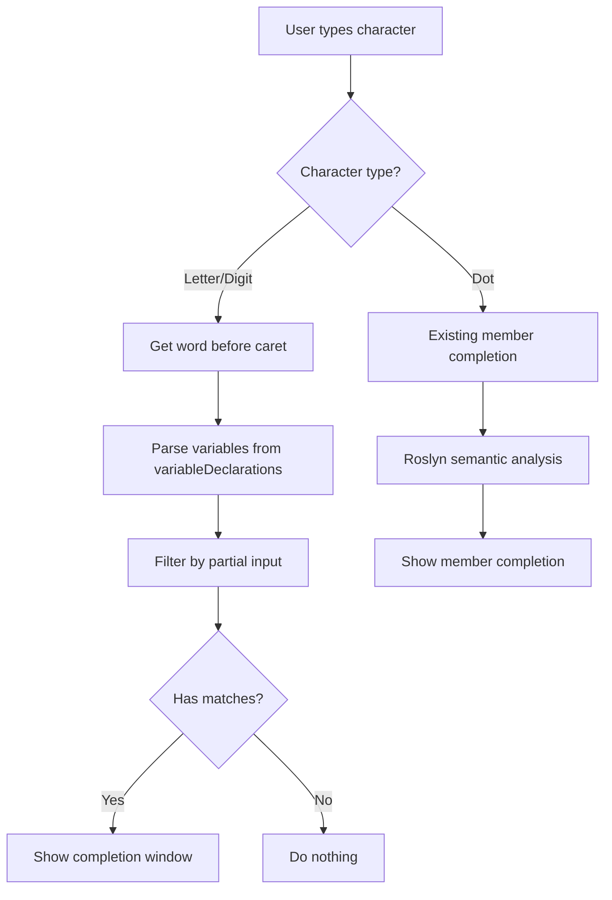

# Roslyn Expression Editor IntelliSense Enhancement Plan

## Objective
Enable IntelliSense autocomplete suggestions for variables and arguments when typing text, while preserving existing dot-based member completion.

## Current State Analysis

### Existing Implementation
The current implementation in [`RoslynExpressionEditorInstance.cs:219`](CSharpExpressionEditor/RoslynExpressionEditorInstance.cs:219) only triggers IntelliSense when the user types a dot (`.`):

```csharp
private void TextArea_TextEntered(object sender, TextCompositionEventArgs e)
{
    if (e.Text == ".")
    {
        // Member completion logic using Roslyn semantic analysis
    }
}
```

### Limitations
- No autocomplete when typing variable names
- No autocomplete when typing argument names  
- User must remember exact variable/argument names
- Only member completion (after dot) works

## Proposed Architecture

### High-Level Design



### Key Components

#### 1. Variable/Argument Data Structure
```csharp
private class VariableInfo
{
    public string Name { get; set; }
    public string TypeName { get; set; }
}
```

#### 2. Helper Methods

**GetWordBeforeCaret()**
- Extract the partial word before the caret position
- Handle edge cases (start of line, after operators, etc.)
- Return empty string if not in identifier context

**ParseVariablesAndArguments()**
- Parse `variableDeclarations` string to extract variable/argument names and types
- Cache results to avoid re-parsing on every keystroke
- Return `List<VariableInfo>`

**FilterCompletions()**
- Filter variable list by partial input (case-insensitive prefix match)
- Sort alphabetically
- Return filtered list

#### 3. Modified TextArea_TextEntered Handler

```csharp
private void TextArea_TextEntered(object sender, TextCompositionEventArgs e)
{
    if (e.Text == ".")
    {
        // Existing member completion logic (unchanged)
        ShowMemberCompletion();
    }
    else if (e.Text.Length > 0 && (char.IsLetter(e.Text[0]) || char.IsDigit(e.Text[0])))
    {
        // New: Show variable/argument completion
        ShowVariableCompletion();
    }
}
```

## Implementation Strategy

### Phase 1: Core Infrastructure
1. Create `VariableInfo` data class
2. Implement `GetWordBeforeCaret()` method
3. Implement `ParseVariablesAndArguments()` method

### Phase 2: Completion Logic  
4. Implement `FilterCompletions()` method
5. Create `VariableCompletionData` class (similar to `QueryCompletionData`)
6. Modify `TextArea_TextEntered` to trigger on letters/digits

### Phase 3: Integration & Polish
7. Add caching for parsed variables
8. Handle completion window updates when filtering
9. Test with various scenarios

## Detailed Implementation Plan

### 1. GetWordBeforeCaret Method

```csharp
private string GetWordBeforeCaret()
{
    int offset = CaretOffset;
    if (offset == 0) return string.Empty;
    
    string text = Text;
    int start = offset - 1;
    
    // Move back while we have valid identifier characters
    while (start >= 0 && (char.IsLetterOrDigit(text[start]) || text[start] == '_'))
    {
        start--;
    }
    
    start++; // Move back to first letter
    return text.Substring(start, offset - start);
}
```

### 2. ParseVariablesAndArguments Method

```csharp
private List<VariableInfo> ParseVariablesAndArguments()
{
    var variables = new List<VariableInfo>();
    
    if (string.IsNullOrWhiteSpace(variableDeclarations))
        return variables;
    
    // Parse format: "TypeName variableName;\n"
    var lines = variableDeclarations.Split(new[] { '\n' }, StringSplitOptions.RemoveEmptyEntries);
    
    foreach (var line in lines)
    {
        var parts = line.Trim().TrimEnd(';').Split(new[] { ' ' }, StringSplitOptions.RemoveEmptyEntries);
        if (parts.Length >= 2)
        {
            variables.Add(new VariableInfo 
            { 
                TypeName = parts[0], 
                Name = parts[1] 
            });
        }
    }
    
    return variables;
}
```

### 3. ShowVariableCompletion Method

```csharp
private void ShowVariableCompletion()
{
    try
    {
        string partialWord = GetWordBeforeCaret();
        if (string.IsNullOrEmpty(partialWord))
            return;
        
        var allVariables = ParseVariablesAndArguments();
        var filtered = allVariables
            .Where(v => v.Name.StartsWith(partialWord, StringComparison.OrdinalIgnoreCase))
            .OrderBy(v => v.Name)
            .ToList();
        
        if (filtered.Count == 0)
            return;
        
        completionWindow = new CompletionWindow(TextArea);
        IList<ICompletionData> data = completionWindow.CompletionList.CompletionData;
        
        foreach (var variable in filtered)
        {
            data.Add(new VariableCompletionData(variable.Name, variable.TypeName));
        }
        
        completionWindow.Show();
        completionWindow.Closed += delegate
        {
            completionWindow = null;
        };
    }
    catch (Exception ex)
    {
        Console.WriteLine(ex.ToString());
    }
}
```

### 4. VariableCompletionData Class

```csharp
public class VariableCompletionData : ICompletionData
{
    public VariableCompletionData(string name, string typeName)
    {
        Text = name;
        Description = $"{typeName} {name}";
    }
    
    public ImageSource Image => null; // Or use variable icon
    public string Text { get; private set; }
    public object Content => Text;
    public object Description { get; private set; }
    public double Priority => 1.0;
    
    public void Complete(TextArea textArea, ISegment completionSegment, EventArgs e)
    {
        // Replace the partial word with the full variable name
        textArea.Document.Replace(completionSegment, Text);
    }
}
```

## Completion Segment Handling

The completion segment should represent the partial word being typed. When showing the completion window:

```csharp
completionWindow = new CompletionWindow(TextArea);
completionWindow.StartOffset = CaretOffset - partialWord.Length;
completionWindow.EndOffset = CaretOffset;
```

## Edge Cases to Handle

1. **Empty partial word**: Don't show completion for single character (optional)
2. **Completion window already open**: Update filtering instead of opening new window
3. **Non-identifier context**: Don't show completion after operators like `+`, `-`, etc.
4. **Caching**: Parse variables only when they change, not on every keystroke

## Testing Scenarios

### Scenario 1: Variable Completion
```
Variables: userName, userAge, userEmail
User types: "use"
Expected: Show completion with userName, userAge, userEmail
```

### Scenario 2: Partial Match
```
Variables: userName, password
User types: "pass"
Expected: Show completion with password only
```

### Scenario 3: Member Completion Still Works
```
Variables: userName
User types: "userName."
Expected: Show member completion (existing logic)
```

### Scenario 4: No Match
```
Variables: userName
User types: "xyz"  
Expected: No completion window shown
```

## Performance Considerations

1. **Caching**: Cache parsed variables and invalidate only when `variableDeclarations` changes
2. **Debouncing**: Consider adding small delay for rapid typing (optional for minimal version)
3. **Filtering**: Use efficient string comparison methods

## File Changes Required

### Modified Files
- [`CSharpExpressionEditor/RoslynExpressionEditorInstance.cs`](CSharpExpressionEditor/RoslynExpressionEditorInstance.cs)
  - Add helper methods
  - Modify `TextArea_TextEntered` handler
  - Add caching field for parsed variables

### New Files
- `CSharpExpressionEditor/VariableCompletionData.cs` (optional - can reuse QueryCompletionData)

## Implementation Risks & Mitigation

### Risk 1: Performance Impact
**Mitigation**: Implement caching and only parse when needed

### Risk 2: Breaking Existing Functionality  
**Mitigation**: Keep dot-based completion logic completely separate

### Risk 3: Incorrect Filtering
**Mitigation**: Thorough testing with various input scenarios

## Success Criteria

- [ ] Variables show in autocomplete when typing their names
- [ ] Arguments show in autocomplete when typing their names
- [ ] Filtering works correctly based on partial input
- [ ] Existing dot-based member completion continues to work
- [ ] No performance degradation
- [ ] No exceptions or crashes

## Next Steps

1. Review and approve this architecture plan
2. Switch to Code mode to implement the solution
3. Test thoroughly with real workflow scenarios
4. Document any additional edge cases discovered during implementation