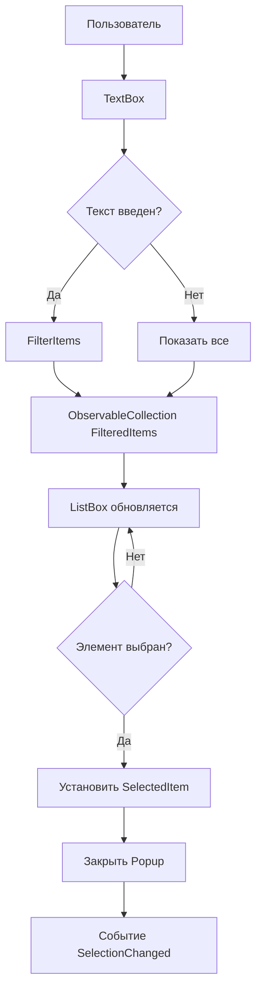

# Архитектура SearchableComboBox Control

## Обзор

SearchableComboBox - универсальный WPF UserControl для выбора элементов из списка с функцией поиска в реальном времени. Контрол разработан для интеграции в проект RPA и совместим с MahApps.Metro UI framework.

## Требования

### Функциональные требования
- ✅ Поддержка работы со строковыми данными (ObservableCollection<string>)
- ✅ Поиск по началу строки в реальном времени
- ✅ Одиночный выбор элемента
- ✅ Выпадающий список с прокруткой
- ✅ Визуальная индикация поискового поля
- ✅ Поддержка привязки данных (data binding)

### Технические требования
- WPF UserControl (чистый WPF)
- Material Icons WPF для иконок (уже в проекте)
- Поддержка MVVM паттерна
- .NET Framework 4.8.1

## Архитектура компонента

### Структура файлов

```
Controls/
├── SearchableComboBox.xaml          # XAML разметка контрола
└── SearchableComboBox.xaml.cs       # Code-behind с логикой
```

### Компоненты UI

#### 1. Основная структура (XAML)
```
Grid (корневой контейнер)
├── TextBox (поле поиска с иконкой)
└── Popup (выпадающий список)
    └── Border
        └── ListBox (список результатов)
```

#### 2. Ключевые элементы

**TextBox для поиска:**
- Отображает текущий выбранный элемент
- При фокусе показывает выпадающий список
- При вводе текста фильтрует список
- Иконка поиска слева (Material Icons)
- Иконка раскрытия списка справа

**Popup с результатами:**
- Открывается при фокусе на TextBox
- Закрывается при потере фокуса или выборе элемента
- Позиционирование под TextBox
- MaxHeight для ограничения высоты

**ListBox с результатами:**
- Отображает отфильтрованные элементы
- Поддержка виртуализации для больших списков
- Highlight выбранного элемента

## Dependency Properties

### ItemsSource
```csharp
public ObservableCollection<string> ItemsSource
```
- Источник данных для списка
- Поддержка two-way binding
- Автоматическая подписка на CollectionChanged

### SelectedItem
```csharp
public string SelectedItem
```
- Текущий выбранный элемент
- Поддержка two-way binding
- Вызывает событие SelectionChanged

### Placeholder
```csharp
public string Placeholder
```
- Текст-подсказка в пустом поле
- По умолчанию: "Search..."

### SearchMode
```csharp
public SearchMode SearchMode { get; set; }
```
- StartsWith (по умолчанию) - поиск по началу строки
- Contains - поиск по содержимому (на будущее)

## Логика работы

### Алгоритм фильтрации

```csharp
private void FilterItems(string searchText)
{
    if (string.IsNullOrWhiteSpace(searchText))
    {
        // Показываем все элементы
        FilteredItems = new ObservableCollection<string>(ItemsSource);
    }
    else
    {
        // Фильтруем по началу строки (case-insensitive)
        var filtered = ItemsSource
            .Where(item => item.StartsWith(searchText, 
                StringComparison.OrdinalIgnoreCase))
            .ToList();
        
        FilteredItems = new ObservableCollection<string>(filtered);
    }
}
```

### Управление состоянием

**Открытие Popup:**
1. TextBox получает фокус → открыть Popup
2. Показать все элементы или отфильтрованные

**Закрытие Popup:**
1. Выбран элемент из списка → закрыть Popup
2. Клик вне контрола → закрыть Popup
3. Нажатие Escape → закрыть Popup

**Выбор элемента:**
1. Клик на элементе в ListBox
2. Установить SelectedItem
3. Обновить текст в TextBox
4. Закрыть Popup
5. Вызвать событие SelectionChanged

## Стилизация

### Цветовая схема
- Фон TextBox: White
- Граница: #CCCCCC
- Граница (фокус): #007ACC (синий акцент)
- Фон выбранного элемента: #E3F2FD
- Hover эффект: #F5F5F5

### Типографика
- Шрифт: Segoe UI (системный)
- Размер текста: 13px
- Размер placeholder: 13px (Opacity: 0.6)

### Анимации
- Плавное открытие/закрытие Popup
- Fade-in для результатов поиска
- Hover эффекты на элементах списка

## Используемые компоненты

### Иконки (MahApps.Metro.IconPacks)
- Material Icons WPF для иконки поиска: `PackIconMaterial Kind="Magnify"`
- Иконка dropdown: `PackIconMaterial Kind="ChevronDown"`
- Библиотека уже используется в проекте

## Примеры использования

### Базовое использование

```xml
<controls:SearchableComboBox 
    ItemsSource="{Binding ModelNames}"
    SelectedItem="{Binding SelectedModelName}"
    Placeholder="Выберите модель..."
    Width="300" />
```

### В AiAgentChatControl

Замена обычного ComboBox:
```xml
<!-- Было -->
<ComboBox Width="250"
          ItemsSource="{Binding AvailableModels}"
          SelectedItem="{Binding SelectedModel}"
          DisplayMemberPath="DisplayName" />

<!-- Станет (с адаптером для AiModel) -->
<controls:SearchableComboBox 
    ItemsSource="{Binding ModelDisplayNames}"
    SelectedItem="{Binding SelectedModelDisplayName}"
    Placeholder="Поиск модели..."
    Width="250" />
```

## Преимущества архитектуры

1. **Универсальность**: Работает с любыми строковыми данными
2. **Переиспользуемость**: Легко интегрируется в разные части приложения
3. **Производительность**: Виртуализация ListBox для больших списков
4. **UX**: Интуитивный поиск в реальном времени
5. **Простота**: Чистый WPF без дополнительных зависимостей

## Ограничения и будущие улучшения

### Текущие ограничения
- Работает только со строками (string)
- Поиск только по началу строки
- Только одиночный выбор

### Потенциальные улучшения
1. Поддержка объектов с DisplayMemberPath
2. Множественный выбор (MultiSelect mode)
3. Группировка элементов
4. Кастомные шаблоны элементов
5. Подсветка найденного текста
6. Keyboard navigation (стрелки, Enter)
7. Асинхронная фильтрация для очень больших списков

## Диаграмма взаимодействия



## Тестирование

### Сценарии тестирования
1. **Базовая фильтрация**: Ввод текста корректно фильтрует список
2. **Регистр**: Поиск не зависит от регистра
3. **Пустой ввод**: Показывает все элементы
4. **Выбор элемента**: Правильно устанавливает SelectedItem
5. **Привязка данных**: Two-way binding работает корректно
6. **Производительность**: Плавная работа со списком 1000+ элементов

### Тестовые данные
```csharp
var testModels = new ObservableCollection<string>
{
    "anthropic/claude-sonnet-4.5",
    "anthropic/claude-3.5-sonnet",
    "openai/gpt-4-turbo",
    "openai/gpt-3.5-turbo",
    "meta-llama/llama-3.1-70b",
    // ... еще 995 элементов
};
```

## Заключение

SearchableComboBox обеспечивает удобный способ выбора элементов из больших списков с возможностью быстрого поиска. Архитектура разработана с учетом требований проекта RPA, паттернов WPF/MVVM и совместимости с MahApps.Metro framework.