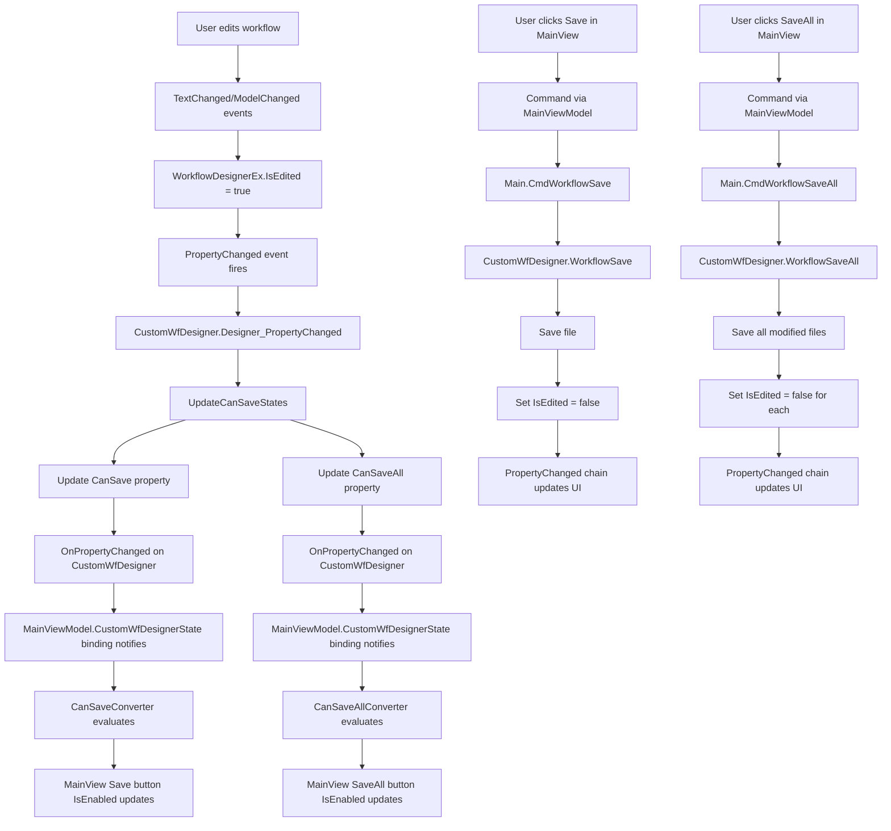
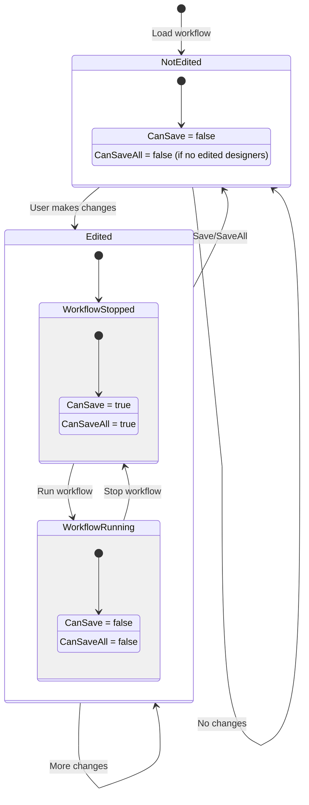

# Workflow Edit Tracking Architecture

## Overview

This document describes the implementation plan for adding edit tracking functionality to the RPA workflow designer. The system will track when workflows are modified and enable/disable Save and SaveAll buttons accordingly.

## MVVM Architecture

The binding structure follows this hierarchy:
- **View**: [`MainView.xaml`](../Views/MainView.xaml)
- **ViewModel**: [`MainViewModel.cs`](../ViewModels/MainViewModel.cs) - exposes `CustomWfDesignerState` property
- **Model**: [`CustomWfDesigner`](../Models/CustomWfDesigner.cs) - contains `CanSave` and `CanSaveAll` properties
- **Designer**: [`WorkflowDesignerEx`](../Etc/WorkflowDesignerEx.cs) - tracks `IsEdited` state

The view binds to properties exposed by [`MainViewModel`](../ViewModels/MainViewModel.cs:31), which provides access to the underlying [`CustomWfDesigner`](../Models/CustomWfDesigner.cs) model.

## Requirements

1. [`WorkflowDesignerEx`](../Etc/WorkflowDesignerEx.cs) must track its edited state via `IsEdited` property
2. [`TextChanged`](../Etc/WorkflowDesignerEx.cs:27) and [`ModelChanged`](../Etc/WorkflowDesignerEx.cs:32) events should set `IsEdited = true`
3. [`CustomWfDesigner`](../Models/CustomWfDesigner.cs) must expose `CanSave` and `CanSaveAll` properties
4. Save button enabled when: workflow stopped AND active designer has `IsEdited = true`
5. SaveAll button enabled when: workflow stopped AND any designer has `IsEdited = true`
6. `IsEdited` reset to `false` after successful save operations and when loading workflows

## Architecture Components

### 1. WorkflowDesignerEx Changes

**File:** [`Etc/WorkflowDesignerEx.cs`](../Etc/WorkflowDesignerEx.cs)

```csharp
public class WorkflowDesignerEx : WorkflowDesigner, INotifyPropertyChanged
{
    private bool _isEdited;
    
    public bool IsEdited
    {
        get => _isEdited;
        set
        {
            if (_isEdited != value)
            {
                _isEdited = value;
                PropertyChanged?.Invoke(this, new PropertyChangedEventArgs(nameof(IsEdited)));
            }
        }
    }
    
    public event PropertyChangedEventHandler PropertyChanged;
    
    private void WorkflowDesignerEx_TextChanged(object sender, TextChangedEventArgs e)
    {
        IsEdited = true;
    }
    
    private void WorkflowDesignerEx_ModelChanged1(object sender, EventArgs e)
    {
        IsEdited = true;
    }
}
```

**Changes:**
- Implement `INotifyPropertyChanged` interface
- Add `IsEdited` property with change notification
- Implement event handlers to set `IsEdited = true` on changes
- Add `PropertyChanged` event

### 2. CustomWfDesigner Changes

**File:** [`Models/CustomWfDesigner.cs`](../Models/CustomWfDesigner.cs)

```csharp
public class CustomWfDesigner : BaseModel
{
    private bool _canSave;
    private bool _canSaveAll;
    
    public bool CanSave
    {
        get => _canSave;
        private set
        {
            _canSave = value;
            OnPropertyChanged();
        }
    }
    
    public bool CanSaveAll
    {
        get => _canSaveAll;
        private set
        {
            _canSaveAll = value;
            OnPropertyChanged();
        }
    }
    
    // In constructor or initialization
    private void InitializeEditTracking()
    {
        WorkflowDesigners.CollectionChanged += WorkflowDesigners_CollectionChanged;
        PropertyChanged += CustomWfDesigner_PropertyChanged;
    }
    
    private void WorkflowDesigners_CollectionChanged(object sender, NotifyCollectionChangedEventArgs e)
    {
        // Subscribe to new designers
        if (e.NewItems != null)
        {
            foreach (WorkflowDesignerEx designer in e.NewItems)
            {
                designer.PropertyChanged += Designer_PropertyChanged;
            }
        }
        
        // Unsubscribe from removed designers
        if (e.OldItems != null)
        {
            foreach (WorkflowDesignerEx designer in e.OldItems)
            {
                designer.PropertyChanged -= Designer_PropertyChanged;
            }
        }
        
        UpdateCanSaveStates();
    }
    
    private void Designer_PropertyChanged(object sender, PropertyChangedEventArgs e)
    {
        if (e.PropertyName == nameof(WorkflowDesignerEx.IsEdited))
        {
            UpdateCanSaveStates();
        }
    }
    
    private void CustomWfDesigner_PropertyChanged(object sender, PropertyChangedEventArgs e)
    {
        if (e.PropertyName == nameof(ActiveWorkflowDesignerEx) || 
            e.PropertyName == nameof(CustomWfDesignerState))
        {
            UpdateCanSaveStates();
        }
    }
    
    private void UpdateCanSaveStates()
    {
        bool isStopped = CustomWfDesignerState == CustomWfDesignerState.Stop;
        
        // CanSave: stopped AND active designer is edited
        CanSave = isStopped && 
                  ActiveWorkflowDesignerEx != null && 
                  ActiveWorkflowDesignerEx.IsEdited;
        
        // CanSaveAll: stopped AND any designer is edited
        CanSaveAll = isStopped && 
                     WorkflowDesigners.Any(d => d.IsEdited);
    }
    
    public void WorkflowSaveAll()
    {
        foreach (var designer in WorkflowDesigners.Where(d => d.IsEdited))
        {
            string loadedFile = designer.CurrentWorkflowFile;
            if (!string.IsNullOrEmpty(loadedFile))
            {
                designer.Save(loadedFile);
                string breakPointsFile = $"{loadedFile}.breakpoints";
                SaveBreakpoints(designer, breakPointsFile);
                designer.IsEdited = false;
            }
        }
    }
}
```

**Changes:**
- Add `CanSave` and `CanSaveAll` properties
- Subscribe to `PropertyChanged` events for all designers
- Implement `UpdateCanSaveStates()` to calculate button states
- Implement `WorkflowSaveAll()` method
- Reset `IsEdited = false` in save methods

### 3. Converters

**File:** [`Converters/WorkflowStateToIsEnabledConverter.cs`](../Converters/WorkflowStateToIsEnabledConverter.cs)

```csharp
/// <summary>
/// Converter for Save button - enabled when stopped AND active designer is edited
/// </summary>
public class CanSaveConverter : IValueConverter
{
    public object Convert(object value, Type targetType, object parameter, CultureInfo culture)
    {
        if (value is CustomWfDesigner designer)
        {
            return designer.CustomWfDesignerState == CustomWfDesignerState.Stop &&
                   designer.ActiveWorkflowDesignerEx != null &&
                   designer.ActiveWorkflowDesignerEx.IsEdited;
        }
        return false;
    }
    
    public object ConvertBack(object value, Type targetType, object parameter, CultureInfo culture)
    {
        throw new NotImplementedException();
    }
}

/// <summary>
/// Converter for SaveAll button - enabled when stopped AND any designer is edited
/// </summary>
public class CanSaveAllConverter : IValueConverter
{
    public object Convert(object value, Type targetType, object parameter, CultureInfo culture)
    {
        if (value is CustomWfDesigner designer)
        {
            return designer.CustomWfDesignerState == CustomWfDesignerState.Stop &&
                   designer.WorkflowDesigners.Any(d => d.IsEdited);
        }
        return false;
    }
    
    public object ConvertBack(object value, Type targetType, object parameter, CultureInfo culture)
    {
        throw new NotImplementedException();
    }
}
```

**Alternative Approach (Using CanSave/CanSaveAll properties):**

Since we're adding `CanSave` and `CanSaveAll` properties to CustomWfDesigner, we can simplify the converters:

```csharp
/// <summary>
/// Converter for Save button - binds to CanSave property
/// </summary>
public class CanSaveConverter : IValueConverter
{
    public object Convert(object value, Type targetType, object parameter, CultureInfo culture)
    {
        return value is CustomWfDesigner designer ? designer.CanSave : false;
    }
    
    public object ConvertBack(object value, Type targetType, object parameter, CultureInfo culture)
    {
        throw new NotImplementedException();
    }
}

/// <summary>
/// Converter for SaveAll button - binds to CanSaveAll property
/// </summary>
public class CanSaveAllConverter : IValueConverter
{
    public object Convert(object value, Type targetType, object parameter, CultureInfo culture)
    {
        return value is CustomWfDesigner designer ? designer.CanSaveAll : false;
    }
    
    public object ConvertBack(object value, Type targetType, object parameter, CultureInfo culture)
    {
        throw new NotImplementedException();
    }
}
```

### 4. MainView.xaml Changes

**File:** [`Views/MainView.xaml`](../Views/MainView.xaml)

Add converters to resources:
```xml
<Window.Resources>
    <converters:CanSaveConverter x:Key="CanSaveConverter"/>
    <converters:CanSaveAllConverter x:Key="CanSaveAllConverter"/>
    ...
</Window.Resources>
```

Update button bindings (lines 210-229):

**Note:** The binding path is `CustomWfDesignerState` which is exposed by [`MainViewModel`](../ViewModels/MainViewModel.cs:31) and returns the [`CustomWfDesigner`](../Models/CustomWfDesigner.cs) instance.

```xml
<!-- Save Button -->
<Button ToolTip="{Binding RelativeSource={RelativeSource Self}, Path=Command.Text}"
        Command="{Binding Cmd}"
        Foreground="#4169E1"
        CommandParameter="CmdWorkflowSave"
        IsEnabled="{Binding CustomWfDesignerState, Converter={StaticResource CanSaveConverter}}"
        Style="{StaticResource LogLevelButtonLastStyle}">
    <materialIcons:MaterialIcon Kind="ContentSaveOutline"
                                Width="20"
                                Height="20" />
</Button>

<!-- SaveAll Button -->
<Button ToolTip="{Binding RelativeSource={RelativeSource Self}, Path=Command.Text}"
        Command="{Binding Cmd}"
        Foreground="#4169E1"
        CommandParameter="CmdWorkflowSaveAll"
        IsEnabled="{Binding CustomWfDesignerState, Converter={StaticResource CanSaveAllConverter}}"
        Style="{StaticResource LogLevelButtonLastStyle}">
    <materialIcons:MaterialIcon Kind="ContentSaveAllOutline"
                                Width="20"
                                Height="20" />
</Button>
```

### 5. Main.cs Changes

**File:** [`Models/Main.cs`](../Models/Main.cs)

Add new command method:
```csharp
/// <summary>
/// Save all modified workflows
/// </summary>
public void CmdWorkflowSaveAll()
{
    CustomWfDesigner.WorkflowSaveAll();
}
```

### 6. Update WorkflowSave Method

**File:** [`Models/CustomWfDesigner.cs`](../Models/CustomWfDesigner.cs:231)

```csharp
public void WorkflowSave()
{
    if (ActiveWorkflowDesignerEx.CurrentWorkflowFile == string.Empty)
    {
        SaveFileDialog dialogSave = new SaveFileDialog
        {
            Title = "Save Workflow",
            Filter = "Workflows (.xaml)|*.xaml",
            FileName = "Workflow"
        };

        if (dialogSave.ShowDialog() == true)
        {
            ActiveWorkflowDesignerEx.Save(dialogSave.FileName);
            string breakPointsFile = $"{dialogSave.FileName}.breakpoints";
            SaveBreakpoints(ActiveWorkflowDesignerEx, breakPointsFile);
            ActiveWorkflowDesignerEx.IsEdited = false;  // Add this line
        }
    }
    else
    {
        string loadedFile = ActiveWorkflowDesignerEx.Context.Items.GetValue<WorkflowFileItem>().LoadedFile;
        string breakPointsFile = $"{loadedFile}.breakpoints";
        ActiveWorkflowDesignerEx.Save(loadedFile);
        SaveBreakpoints(ActiveWorkflowDesignerEx, breakPointsFile);
        ActiveWorkflowDesignerEx.IsEdited = false;  // Add this line
    }
}
```

### 7. LoadActivityToDesignerHelper Changes

**File:** [`Helpers/LoadActivityToDesignerHelper.cs`](../Helpers/LoadActivityToDesignerHelper.cs:29)

After loading the workflow, set `IsEdited = false`:

```csharp
internal static WorkflowDesignerEx LoadActivityToDesigner(string sourceFile)
{
    // ... existing code ...
    
    workflowDesignerEx.Save(sourceFile);
    workflowDesignerEx.IsEdited = false;  // Add this line
    
    return workflowDesignerEx;
}
```

## Data Flow Diagram



## State Diagram



## Implementation Checklist

- [ ] Add `IsEdited` property to [`WorkflowDesignerEx`](../Etc/WorkflowDesignerEx.cs:8)
- [ ] Implement `INotifyPropertyChanged` in [`WorkflowDesignerEx`](../Etc/WorkflowDesignerEx.cs:8)
- [ ] Implement event handlers to set `IsEdited = true`
- [ ] Add `CanSave` and `CanSaveAll` properties to [`CustomWfDesigner`](../Models/CustomWfDesigner.cs:23)
- [ ] Subscribe to designer `PropertyChanged` events
- [ ] Implement `UpdateCanSaveStates()` method
- [ ] Create `CanSaveConverter` and `CanSaveAllConverter`
- [ ] Update [`MainView.xaml`](../Views/MainView.xaml) button bindings
- [ ] Implement `CmdWorkflowSaveAll` in [`Main.cs`](../Models/Main.cs)
- [ ] Implement `WorkflowSaveAll()` method
- [ ] Reset `IsEdited` in save methods
- [ ] Set `IsEdited = false` in [`LoadActivityToDesignerHelper`](../Helpers/LoadActivityToDesignerHelper.cs:29)

## Testing Strategy

1. **Load workflow** - verify `IsEdited = false`, buttons disabled
2. **Edit workflow** - verify `IsEdited = true`, buttons enabled (when stopped)
3. **Save single workflow** - verify `IsEdited = false`, button disabled
4. **Edit multiple workflows** - verify `CanSaveAll = true`
5. **SaveAll** - verify all `IsEdited = false`
6. **Run workflow while edited** - verify buttons disabled during run
7. **Stop workflow** - verify buttons re-enabled if still edited
8. **Switch between tabs** - verify `CanSave` updates for active designer

## Notes

- The implementation uses `INotifyPropertyChanged` to ensure proper MVVM data binding
- `CanSave` and `CanSaveAll` are computed properties that update automatically
- Both workflow state and edit state are considered for button enabling
- The system properly handles multiple open workflow designers
- Event subscriptions are managed to prevent memory leaks